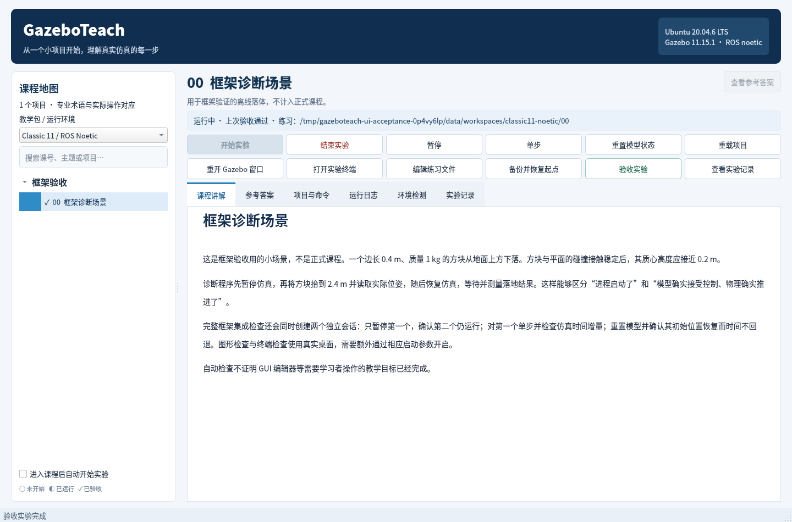

# GazeboTeach

面向聪明初学者的 Gazebo 桌面教学工作台。使用真实 Gazebo 场景、终端和观测数据学习建模、物理、传感器、ROS 集成与插件开发。

首个课程包：**Ubuntu 20.04 / Gazebo Classic 11 / ROS Noetic**，验证设备为 ikaros。

桌面框架已通过 ikaros 真实运行验收，正式课程按编号逐次加入。课程完成状态以验证记录和 `--list` 为准，尚未验收的本地草稿不计入发布内容。

## 启动

在 ikaros 图形桌面中运行：

```sh
cd /home/ikaros/GazeboTeach
./launch.sh
```

SSH 调试时应使用该用户的实际图形会话。常规桌面启动不需要手工设置 DISPLAY。




教材和模型资源本地保存；先修资料链接在系统浏览器打开。应用保留每课个人练习副本，课程原始模板与参考材料不会被练习覆盖。

本次交付正式主课：**01–16，共 16 课**。各课含可修改实验、只读参考答案，以及基准场景、变式挑战和错误配置的真实验收；完整标题见应用课程地图或 `--list`。L09基础以真实关节状态测量被动单摆和重力滑轨。

L10用原生关节控制器驱动电机转台，对照恒转矩、速度P、速度PI、位置P、位置PD与低转矩上限PI六个阶段；通过个人参数修改、重载和1 kHz真实记录学习稳态误差、超调、微分突跳、积分项限幅与执行能力边界。它是理想转矩执行器和机械转子的模型，不要求先学ROS或编写插件。

L11用原生差速插件与真实轮地接触驱动小车，比较直行、自转和圆弧的运动学预测、轮编码里程计与世界真值；通过前向速度单变量挑战和低摩擦直行理解轮速、车体运动与滑移的关系，并提供同一真实记录的轮距标定离线回算。

L12以真实受力滑门学习Classic Transport：发现主题与消息类型，执行发布/订阅和关联请求响应，通过暂停、复位与双Master对照分清received、applied、completed三层证据。SDK工具与PD控制器已提供，学员可直接在实验终端操作，无需先写插件或ROS节点。

L13以离线场景展厅串起材质与纹理、三类灯光与阴影、真实高度场碰撞和Actor路径/骨骼动画。65×65高度图、物理射线与六个落球验证几何和支撑，真实GUI另检查高光、地表纹理、照明和人物动作。课程新建Gazebo窗口时自动定位总览并读回实际相机姿态；已有窗口保留学生调整的视角，新开窗口才重新初始化。

L14用ROS接触消息观察真实落块：比较台面外落地、空中无接触、触地和持续支撑。只改质量或落高并重载，分别验证支持力与自由落体；教材解释接触点、跨时刻批量记录及力反馈坐标，避免把一包不同时刻的力误加成合力。原始消息、唯一仿真时间与实际位姿共同构成验收依据。

L15把扫描角度映射到LaserScan数组，比较同位CPU/GPU激光、九束墙面几何、无回波和只有碰撞/只有外观的目标。只改束数或墙距并重载，再实际移墙1m验证测距；每阶段采集双路连续新消息，最终恢复进入时的墙体与暂停状态。为避开系统两类激光插件的同名类冲突，课程自动编译独立GPU适配器，仅转发真实原生GPU扫描。

L16通过正立静止、倾斜静止、正转、反转和真实自由落体五阶段学习IMU。比力按机体系的a−g解释，姿态来自仿真状态而非暗中完成传感器融合；真实消息、四元数变化和独立位置/速度查询共同验收。只初始化状态，随后由ODE推进，结束后恢复两模型进入时状态及暂停。

另已交付 **L09选做A：单级倒立摆控制（091）**与**选做B：双级倒立摆控制（092）**，在课程树“关节与机构”中进入。两项均通过三个Python填空完成状态误差、给定LQR反馈与双向限幅，提供分层提示及独立只读答案；双杆项目进一步学习相对关节角到六维绝对状态的转换。参考演示与学生代码的函数、真实三回合验收分别记录，默认TODO仍留给学员完成。

本次交付合计**16门主课与2项选做，共18个项目**。真实物理、图形与桌面验收证据见[验证记录](docs/VALIDATION_LOG.md)，发布状态以main提交及远端核对为准。2026-10-31用户明确继续后恢复逐课实施；L16完成发布核对后进入L17。主课01–37保持原编号，091/092不占用原主课编号。两项倒立摆均针对近直立局部稳定，完整起摆需另建扩展项目，个人填写不会自动被参考代码覆盖。

原有14–16旧草稿已分别审查、重写并逐课验收；后续L17–L37与最终回归仍待按计划实施，不计入上述交付清单。

## 工作流程

启动脚本定位项目 → 探测实际模拟器与 ROS 环境 → 匹配课程包 → 选择课程 → 准备练习副本 → 启动本课独立仿真 → 打开观察/操作终端 → 根据真实状态验收 → 保存记录并停止本课进程。

每课提供目标、必要背景、输入到输出的信息流、文件结构、单变量实验、结果解释、错误诊断、挑战和可观察验收。更改控制器或插件时，教材同步解释算法处理流程。

## 环境诊断与框架检查

```sh
./launch.sh --diagnose
./launch.sh --list
./launch.sh --smoke-fixture tests/fixtures/diagnostic --gui --terminals
python3 -m unittest discover -s tests -q
python3 tests/integration_probe.py --gui --terminals --report /tmp/gazeboteach-integration.json
python3 tests/ui_probe.py --screenshot /tmp/gazeboteach-ui.png --gazebo-screenshot /tmp/gazeboteach-gazebo.png --report /tmp/gazeboteach-ui.json
```

图形检查需要真实桌面。诊断场景不计入正式课程；自动检查为每次运行创建独立练习副本，保留日志。框架已验证 Qt 5.12、真实 Gazebo 图形、终端任务控制、双会话隔离、暂停/单步/重置、窗口恢复、练习持久化与自有进程清理。

## 开发与部署

- [执行计划](docs/EXECUTION_PLAN.md)
- [框架运行流程](docs/framework-flow.md)
- [验证记录](docs/VALIDATION_LOG.md)
- [Windows 中转流程](docs/relay-flow.md)

代码在 ikaros 实际运行、调试，通过 Windows 本机推送 GitHub。GitHub 私钥仅保留在 Windows。部署和构建缓存、练习工作区以及实验日志不纳入源码。

## 许可

保留仓库原有 MIT License，详见 LICENSE。
