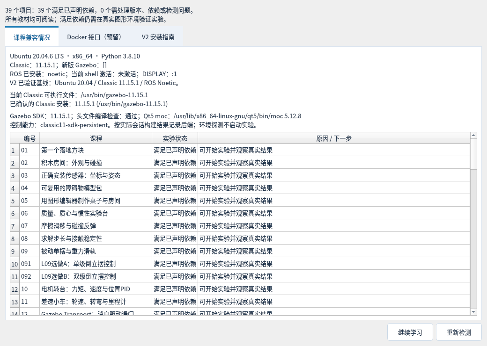
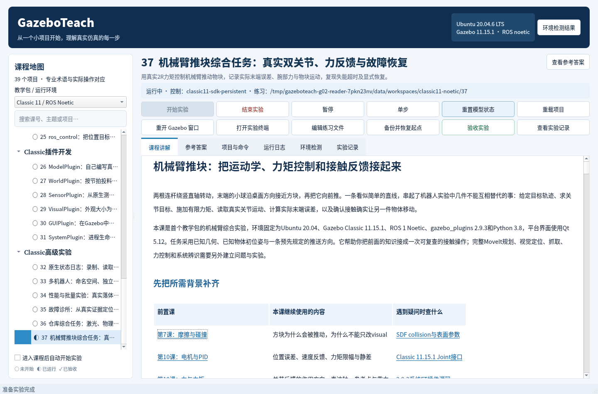
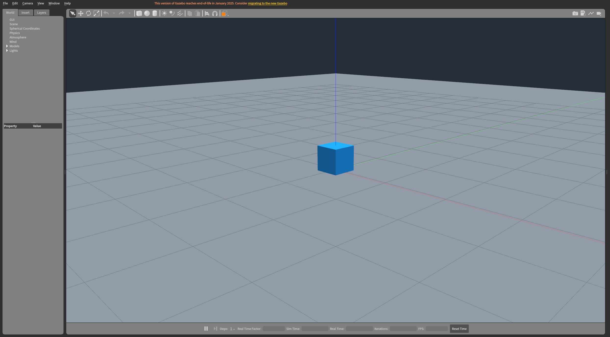

# GazeboTeach

**V2 包含37门主课和2项倒立摆选做，共39个项目**，在本地中文桌面应用中学习、修改并验收真实Gazebo小实验。

[安装运行指南](docs/V2_INSTALL.md) · [完整课表](docs/V2_CURRICULUM.md) · [V2发行资源与验证报告](https://github.com/StareamCather/GazeboTeach/releases/tag/v2.0.0) · [兼容检测](docs/ENVIRONMENT_V2.md) · [手动Docker配置](docs/V2_DOCKER.md)

已验证课程环境为Ubuntu20.04、Gazebo Classic11.15.1与ROS Noetic。启动时显示实际软件、SDK及逐课依赖结果；其他环境可阅读教材，实验按兼容情况开放。新版Gazebo/ROS2课程尚未移植，Docker提供配置接口与手动指南。



V1保留24门主课及2项选做的历史快照，见[V1指南](docs/V1_INSTALL.md)与[V1发行资源](https://github.com/StareamCather/GazeboTeach/releases/tag/v1.0.0)。

面向聪明初学者的 Gazebo 桌面教学工作台。使用真实 Gazebo 场景、终端和观测数据学习建模、物理、传感器、ROS 集成与插件开发。

首个课程包：**Ubuntu 20.04 / Gazebo Classic 11 / ROS Noetic**，验证设备为 ikaros。

桌面框架与全部39个项目已逐课交付；实际行为、图形检查和后续回归分别留证，详见验证记录与发行验证报告。


在已验证的 Classic 11.15.1 SDK 环境中，暂停、单步和模型复位复用持久原生连接，逐次检查真实状态并在退出时完成线程清理；详见[控制后端与算法](docs/NATIVE_CONTROL.md)。缺少匹配SDK时会明确报告原有CLI后端。

## 启动

在 ikaros 图形桌面中运行：

```sh
cd /home/ikaros/GazeboTeach
./launch.sh
```

SSH 调试时应使用该用户的实际图形会话。常规桌面启动不需要手工设置 DISPLAY。





教材和模型资源本地保存。内部先修课程在独立只读窗口打开，当前实验继续运行；外部资料使用系统浏览器。个人练习自动保留，模板更新时提示差异；恢复起点前保存完整备份。

本次交付正式主课：**01–37，共 37 课**。各课含可修改实验、只读参考答案，以及基准场景、变式挑战和错误配置的真实验收；完整标题见应用课程地图或 `--list`。L09基础以真实关节状态测量被动单摆和重力滑轨。

L10用原生关节控制器驱动电机转台，对照恒转矩、速度P、速度PI、位置P、位置PD与低转矩上限PI六个阶段；通过个人参数修改、重载和1 kHz真实记录学习稳态误差、超调、微分突跳、积分项限幅与执行能力边界。它是理想转矩执行器和机械转子的模型，不要求先学ROS或编写插件。

L11用原生差速插件与真实轮地接触驱动小车，比较直行、自转和圆弧的运动学预测、轮编码里程计与世界真值；通过前向速度单变量挑战和低摩擦直行理解轮速、车体运动与滑移的关系，并提供同一真实记录的轮距标定离线回算。

L12以真实受力滑门学习Classic Transport：发现主题与消息类型，执行发布/订阅和关联请求响应，通过暂停、复位与双Master对照分清received、applied、completed三层证据。SDK工具与PD控制器已提供，学员可直接在实验终端操作，无需先写插件或ROS节点。

L13以离线场景展厅串起材质与纹理、三类灯光与阴影、真实高度场碰撞和Actor路径/骨骼动画。65×65高度图、物理射线与六个落球验证几何和支撑，真实GUI另检查高光、地表纹理、照明和人物动作。课程新建Gazebo窗口时自动定位总览并读回实际相机姿态；已有窗口保留学生调整的视角，新开窗口才重新初始化。

L14用ROS接触消息观察真实落块：比较台面外落地、空中无接触、触地和持续支撑。只改质量或落高并重载，分别验证支持力与自由落体；教材解释接触点、跨时刻批量记录及力反馈坐标，避免把一包不同时刻的力误加成合力。原始消息、唯一仿真时间与实际位姿共同构成验收依据。

L15把扫描角度映射到LaserScan数组，比较同位CPU/GPU激光、九束墙面几何、无回波和只有碰撞/只有外观的目标。只改束数或墙距并重载，再实际移墙1m验证测距；每阶段采集双路连续新消息，最终恢复进入时的墙体与暂停状态。为避开系统两类激光插件的同名类冲突，课程自动编译独立GPU适配器，仅转发真实原生GPU扫描。

L16通过正立静止、倾斜静止、正转、反转和真实自由落体五阶段学习IMU。比力按机体系的a−g解释，姿态来自仿真状态而非暗中完成传感器融合；真实消息、四元数变化和独立位置/速度查询共同验收。只初始化状态，随后由ODE推进，结束后恢复两模型进入时状态及暂停。

L17使用真实RGB相机和本课实时图像窗口，读取Image字节与CameraInfo，观察红色目标远移、横移，以及分辨率/FOV单变量。按实际时间戳配对，用真实像素和八角点投影核对内参、光学坐标与成像关系；保留原始RGB、指纹和[实际相机图像](docs/images/lesson17-camera.png)，不根据预测公式生成验收画面。

L18直接解码32FC1深度和有序PointCloud2，比较轴向Z、径向距离、像素反投影与实际字段步长。近／远探针区分原生裁剪与软件无效值；只改分辨率或远端阈值，验证墙体平移后的深度变化。提供[深度伪彩预览](docs/images/lesson18-depth-pseudocolor.png)和[同场景真实RGB](docs/images/lesson18-rgb.png)，原始浮点与点云字节另外保留，显示颜色不替代米制数据。

L19用真实固定关节承载偏心质量，对照三路原生力／力矩传感器与系统ROS关节反馈，比较作用方向、旋转坐标轴、力矩参考点及r×F。只改质量或力臂并重载，验证力和力矩的不同变化；不搬动被世界约束的机构或写入测量值。

L20把GPS、磁力计、高度计、声纳和Logical Camera放在同一离线展台，逐项使用实际原生消息与真实状态验收。通过导航台上移、平移、偏航及真实惯性上升，区分椭球高度、初始化高度参考、机体系磁场和速度；再比较声纳障碍/超量程、逻辑相机进出视锥及无遮挡剔除。原生时间与桥接接收时间明确区分，两个单变量配置保留为个人练习。

L21以真实相机、IMU与世界统计区分模拟时间、接收耗时和采样标签；通过暂停、真正单步/多步及完整重启的lockstep对照学习频率与时间配对。相机成功原生Update计数、原生消息标签覆盖密度与ROS接收率分层记录，保留重复/回退，不改时间戳或把排序当作同步修复；图像原字节外存并用SHA引用。相机Hz和物理步长分别作为重载单变量，独立子实验的取消与应用关闭均已真实验证。

L22复用平台私有ROS Master和Gazebo，通过真实roslaunch组织driver与observer两个节点，学习package、include、arg、私有参数、namespace和remap。有限力服务让1kg试块先加速后匀速，实际节点身份、参数、ModelStates反馈及独立状态查询共同验证通信图；只改力值或namespace并重载。取消任务保留惯性，静态启动预览与运行图分开，节点退出与Gazebo内部任务生命周期也分别检查。

L23用水平2R机械臂学习URDF树、joint origin/axis、Xacro宏与条件、质心惯性及Classic转换。只改连杆长度或fixed工具保留，核对真实生成文件、原生碰撞几何与实际物性；三个静态姿态和正负/限位力矩实验分别验证FK与真实动力学。非零速度快照恢复按link原点与质心的参考点差异补偿，原始测量和验收阈值保持。

L24把真实Gazebo关节状态送入系统JointState插件和robot_state_publisher，在[RViz实际画面](docs/images/lesson24-rviz.png)中对照机器人、TF轴与坐标树。只改发布频率或TF前缀，区分ROS名称空间、frame名、原消息时间与接收时间；暂停、真实单步和时间回退使用同一listener验证动态缓存清理及静态边保留。RViz独立重开与实验退出清理另有真实图形证据。

L25以固定水平转杆串起URDF transmission、Effort接口、官方PID和controller_manager。官方0.22源码在个人目录离线构建，比较主/软控制器、STRICT冲突、加载卸载、限位和真实反馈；只改比例增益或目标并重载。恢复分别核对物理q/qd、生命周期和暂停，软件历史不回填。见[实际桌面](docs/images/lesson25-ui.png)与[Gazebo模型](docs/images/lesson25-gazebo.png)。

L26从零编译真实ModelPlugin，通过WorldUpdateBegin读取关节速度并施加驱动力矩与线性阻尼。三组独立原生位姿与解析运动比较，区分插件回调仪表、实际物理运动和载入/复位生命周期；本例model-only复位保留内部转角、清零速度，重载才重新建立初始角度。见[实际桌面](docs/images/lesson26-ui.png)与[Gazebo转子](docs/images/lesson26-gazebo.png)。

L27用世界插件按模拟节拍异步投料，再按实际实体ID回收自己的方块。通过原生Scene、实体和连续位姿区分请求、出现、下落、落稳与删除完成；对照模型复位和全世界复位，保留外部哨兵。SDK9复制精度和客户端退出线程屏障单独说明，实际运动不由插件计数替代。见[实际桌面](docs/images/lesson27-ui.png)与[三块投料场景](docs/images/lesson27-batch.png)。

L28为真实CPU RaySensor编写SensorPlugin，从三束原始测距计算最近距离、EMA与距离状态。五阶段实际移动目标，用原生扫描独立重算过滤及判断，明确无回波为unknown、恢复重种子；对照阈值与alpha单变量，区分20Hz采样、物理步进和时钟回退。见[实际桌面](docs/images/lesson28-ui.png)与[射线场景](docs/images/lesson28-gazebo.png)。

L29在真实Gazebo客户端渲染线程修改专有材质和visual缩放，同时核对服务端1米碰撞体保持不变。原生窗口像素独立验证[蓝色变式](docs/images/lesson29-blue.png)与[1.4倍视觉缩放](docs/images/lesson29-scale.png)，区分属性回读、实际画面和物理几何；暂停物理后仍可渲染和更改外观，GUI重开会建立新的插件实例。见[实际桌面](docs/images/lesson29-ui.png)。

L30在真实gzclient中加入Qt控制面板，以MOC、信号槽和线程缓存串起暂停、继续和N步控制。独立X11鼠标点击按钮后，用原生时钟、迭代数及落块位置确认效果；100/200步与小数显示精度分别实验，控制只发送一次，不凭按钮文字猜完成。见[实际面板](docs/images/lesson30-gazebo.png)与[课程工作台](docs/images/lesson30-ui.png)。

L31通过gzserver -s加载SystemPlugin，记录进程Load/Init、世界创建和首次物理更新的真实边界。实际配置9.8/4.9重力并核对落体，改变采样stride则只影响记录数；用独立原生姿态分清prephysics标签与积分结果，完整世界复位也不伪调进程插件Reset。见[实际桌面](docs/images/lesson31-ui.png)与[Gazebo实验](docs/images/lesson31-gazebo.png)。

L32使用Gazebo原生记录器生成state.log，在隔离的真实gzserver -p中回放。分别核对原世界、原始日志与播放器的原生时钟/姿态，解释模型与canonical link文本精度、变化状态采样及静止后的保留状态；实际验证zlib/txt/bz2与真实回放时间轴。见[中文桌面](docs/images/lesson32-ui.png)、[原实验](docs/images/lesson32-gazebo.png)和[原生回放窗口](docs/images/lesson32-playback.png)。

L33在同一世界放置两台真实轮驱差速车，分别隔离Gazebo模型、ROS话题和TF坐标名。通过alpha直行、beta自转、两车并发及真实停车反馈，核对世界真值、轮关节、原始odom/TF与命令，使用world来源里程计并解释出生坐标和单位静态桥。见[中文桌面](docs/images/lesson33-ui.png)与[双车实机画面](docs/images/lesson33-gazebo.png)。

L34以8/24个方块、1/2ms步长各重复两次，实际启动8个隔离无GUI服务端，保存原生落体/接触状态与JSON/CSV。明确启动、控制、查询和清理的计时边界，保留种子/源码/SDK指纹；不以端到端吞吐冒充引擎RTF，不预设性能排序。见[中文桌面](docs/images/lesson34-ui.png)与[真实预览](docs/images/lesson34-gazebo.png)。

L35在隔离副本复现SDF解析、插件加载、重力和碰撞四类故障，使用原生解析输出、Physics/实体、日志、实际ELF与运动证据诊断，再新建修复文件并重跑。匿名输入验证诊断不依赖案例路径，保留故障与学员内容；实际演示工具退出码0也不一定表示解析成功。见[中文桌面](docs/images/lesson35-ui.png)与[正常预览](docs/images/lesson35-gazebo.png)。

**L36 仓库综合任务**整合真实差速车、CPU激光、物理滑门与有限状态机：车在门前等待实际关节开度和扫描净空，过门、关门后到目标区，以真实末速确认停车。独立复现堵门超时并保留位置恢复，比较单变量速度效果；CSV/SVG由真实扫描和时间差受限的前序odom生成，逐点复算，不宣称SLAM。独立物理验收74.613s、桌面13项43.159s通过，实际原始数据和清理证据完整保留。

**L37 机械臂综合实验**用真实双关节力矩控制推动积木，核对FK参考偏置、实际末端误差、腕部六维受力与物块运动。独立复现执行器失效、保留失败证据并以原生模型复位恢复；两种时长下实测积木均移动约0.230m，速度比约1.496。CSV与七条SVG曲线逐点复算，位置保持由实际速度和误差确认。独立行为55.281s、桌面13项26.836s通过，全部39个项目已逐课交付。

另已交付 **L09选做A：单级倒立摆控制（091）**与**选做B：双级倒立摆控制（092）**，在课程树“关节与机构”中进入。两项均通过三个Python填空完成状态误差、给定LQR反馈与双向限幅，提供分层提示及独立只读答案；双杆项目进一步学习相对关节角到六维绝对状态的转换。参考演示与学生代码的函数、真实三回合验收分别记录，默认TODO仍留给学员完成。

本版合计**37门主课与2项选做，共39个项目**。真实物理、图形与桌面证据见[验证记录](docs/VALIDATION_LOG.md)，源码、安装资源和逐项校验见[V2发行报告](https://github.com/StareamCather/GazeboTeach/releases/tag/v2.0.0)。主课01–37保持原编号，091/092不占用主课编号。倒立摆学习近直立局部稳定，完整起摆属于扩展问题；个人填写不会自动被参考代码覆盖。

每课均有离线场景、完整教材、可修改练习和真实行为验收。自动检查使用新练习副本；091/092的自动参考验收仅在私有副本中填写，发布模板保留学员填空。

## 工作流程

启动脚本定位项目 → 探测实际模拟器与 ROS 环境 → 匹配课程包 → 选择课程 → 准备练习副本 → 启动本课独立仿真 → 打开观察/操作终端 → 根据真实状态验收 → 保存记录并停止本课进程。

每课提供目标、必要背景、输入到输出的信息流、文件结构、单变量实验、结果解释、错误诊断、挑战和可观察验收。更改控制器或插件时，教材同步解释算法处理流程。

## 环境诊断与框架检查

```sh
./launch.sh --diagnose
./launch.sh --list
./launch.sh --smoke-fixture tests/fixtures/diagnostic --gui --terminals
python3 -m unittest discover -s tests -q
python3 tests/integration_probe.py --gui --terminals --report /tmp/gazeboteach-integration.json
python3 tests/ui_probe.py --screenshot /tmp/gazeboteach-ui.png --gazebo-screenshot /tmp/gazeboteach-gazebo.png --report /tmp/gazeboteach-ui.json
```

图形检查需要真实桌面。诊断场景不计入正式课程；自动检查为每次运行创建独立练习副本，保留日志。框架已验证 Qt 5.12、真实 Gazebo 图形、终端任务控制、双会话隔离、暂停/单步/重置、窗口恢复、练习持久化与自有进程清理。

## 开发与部署

- [V2安装运行指南](docs/V2_INSTALL.md)
- [完整课表与先修关系](docs/V2_CURRICULUM.md)
- [V2变更说明](docs/RELEASE_NOTES_V2.md)
- [执行计划](docs/EXECUTION_PLAN.md)
- [框架运行流程](docs/framework-flow.md)
- [验证记录](docs/VALIDATION_LOG.md)
- [Windows 中转流程](docs/relay-flow.md)

代码在 ikaros 实际运行、调试，通过 Windows 本机推送 GitHub。GitHub 私钥仅保留在 Windows。部署和构建缓存、练习工作区以及实验日志不纳入源码。

## 许可

保留仓库原有 MIT License，详见 LICENSE。
