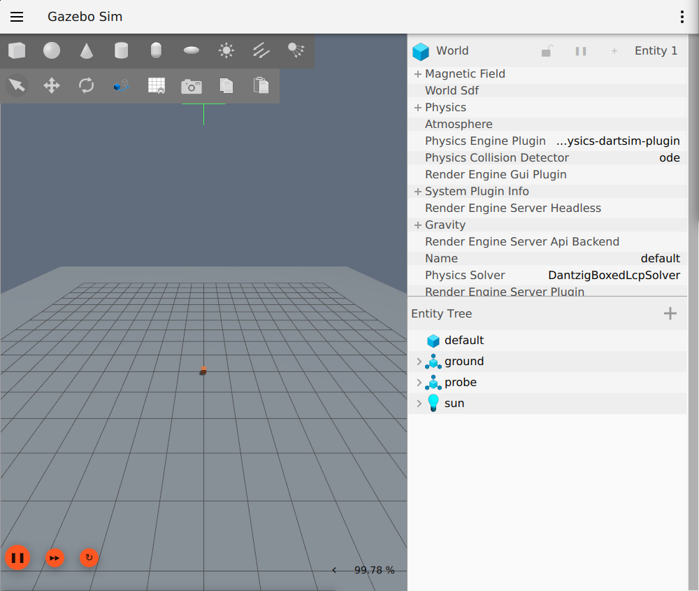
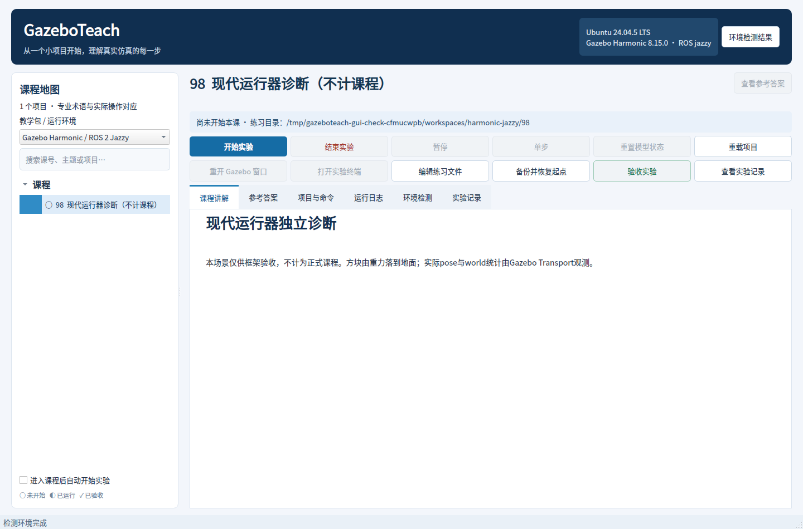
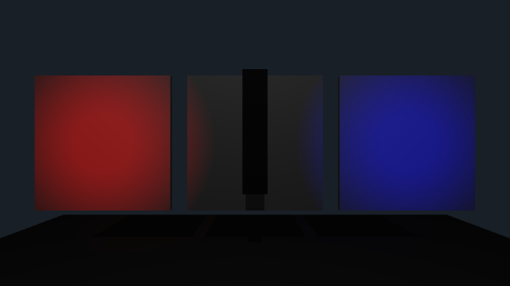
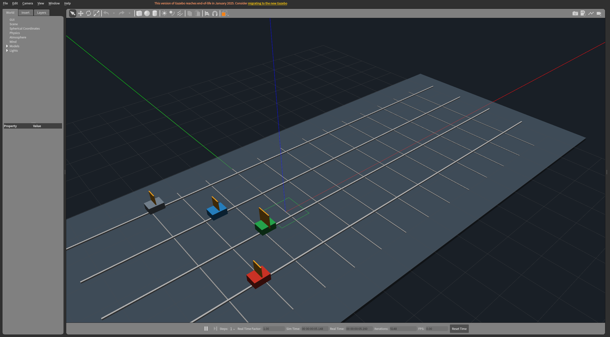
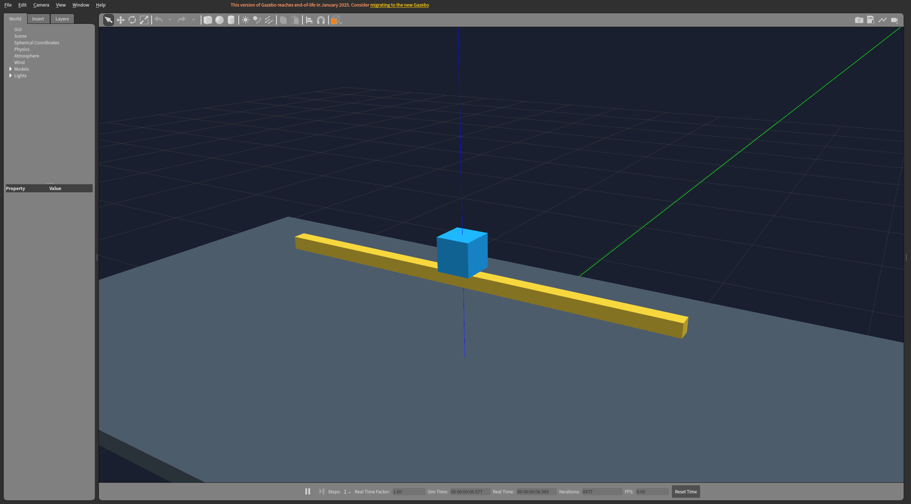

# 附加专项与现代版本验证记录

本记录区分原V2发行快照、后续源码框架与逐门新增课程。原01–37及091/092课程文件保持不变。实施顺序见[计划](EXPANSION_PLAN.md)，LIO源码和数据契约见[实现前核查](LIO_IMPLEMENTATION_NOTES.md)。

## G03：计划与版本适配框架

2026-11-03，计划提交 `5486cb766855f119d48f46bd26d921c3ce13fd7a` 已推送并核对GitHub main。框架采用独立`harmonic-jazzy`配置，不把Classic课程改为ROS2课程。

| 范围 | 实际结果 |
| --- | --- |
| Windows单元/界面/打包检查 | 全套195项通过，4项Linux平台检查跳过；随后新增黑屏门禁，现代与界面29项针对性检查通过 |
| ikaros原生Classic回归 | 全套195项通过；真实GUI和两个PTY的框架集成30.396秒通过，两个私有Master、暂停隔离、重置与owned进程清理通过 |
| 现代环境 | 隔离Ubuntu24.04.5容器、Python3.12、Qt5.15、Jazzy、Gazebo Sim8.15.0（Harmonic）；宿主仍Ubuntu20.04/Classic/Noetic |
| 现代真实框架 | 18.127秒，13项检查通过：真实重力落块、暂停、精确单步/十步、继续、真实初始/重开窗口、两个PTY、Transport partition/DDS domain租约不同、停止一个世界另一个继续、无测试owned进程残留 |
| 单步实际证据 | 迭代4634→4635，仿真4.634→4.635秒；随后十步到4645/4.645秒，保持暂停 |
| 现代桌面应用 | 独立诊断fixture的环境结果弹窗、中文正文、profile选择及退出通过；该fixture不计正式课程 |
| 现代CLI工厂 | --smoke-fixture真实Gazebo、GUI与两个终端通过，并完成清理 |
| 最新针对性回归 | Windows/ikaros均29项通过，覆盖版本、环境污染、子PATH工具、错误探测汇总、精确步数及黑屏拒绝、现代界面复位禁用 |

截图人工核对了地面/网格、已落地试块、实体树和控制栏；初始与单独重开后画面均存在。像素门禁只是排除黑屏/近空白，不能替代场景内容检查。

### 算法与行为变化

检测实际Sim版本及Jazzy包索引 → 清理外层ROS/其它Gazebo的路径和插件配置 → 按课包profile构造对应运行器 → 分配独立partition与DDS domain租约 → 准备个人副本 → 启动gz sim服务端并等待control服务和真实统计 → 启动辅助节点、GUI与终端。控制只发送一次请求，暂停/步进通过实际统计确认；退出只清理本课token对应的进程，最后释放domain租约。完整流程见[现代适配说明](MODERN_GAZEBO.md)。

Harmonic不支持保留时钟的model-only复位，界面禁用该按钮并提示重载；没有用全量reset替代而悄悄倒退时钟。现代运行器与Classic复用存储、真实PTY及所有权清理，终端可执行文件从本课子环境PATH解析。

### 本次发现及修复

- 现代探测失败未汇入总报告：现在逐课与总报告都显示检测未完成并去重错误，不误伤Classic可运行课程。
- 已激活其它ROS/Gazebo时可能泄漏插件或工具：source Jazzy前清除外来配置，用子环境解析工具，缺失/未检测分别报告。
- 只有窗口PID和尺寸的检查曾接受全黑截图：新增颜色/亮度/非黑比例门禁和人工核图。纯软件Mesa连到本机NVIDIA X会话时出现`failed to create drawable`；该尝试不计为图形通过。
- 最终图形测试使用本机现有535.183.01驱动对应用户态库的只读绑定及显卡设备透传，未更换宿主驱动、未配置全局xhost、未修改Docker daemon或默认网络。中文字体在容器中准备后核对。

### 证据与边界

原始机器报告保留在ikaros及Windows工作副本的`.deploy/`：`g03-classic-framework.json`、`g03-gpu-evidence/g03-modern-framework.json`、现代CLI/应用stdout、截图、单元测试输出。固定摘要和输入哈希见[G03验证数据](verification/G03.json)。失败日志也保留，不用旧成功结果覆盖新失败。

本阶段验证的是运行器，不认证任何新增课程；现有附加课草稿尚未逐门交付。DDS domain租约不同已经检查，真实ROS2消息发现/QoS隔离留待相应课程。Humble/Fortress、Ionic、Jetty等组合尚无对应实验适配；Docker宿主调度接口仍预留，当前测试从容器内部运行native后端。

## A38：精细工厂附加专项

2026-11-03，独立新增课程38，不改原课程。72个真实模型、离线324三角形机床网格；货架净距从实际生成几何核对为1.8m，后墙使用三块碰撞体留下1.4×2.1m门洞。

新副本真实构建/GUI/双PTY及单变量验收19.836秒通过。三颗球的实际球心分别为1.080、.480、.080m；只改个人台面高度1.0→1.2m并重新进入后，台面球变为1.280m，托盘与间隙球保持原高度。插件只从求解后的真实模型读取位姿/速度，预测值只用于比较。个人网格不由prepare覆盖；个人参数→SDF装配→缓存构建观察插件→真实物理→稳定判定的流程写在教材中。

另从真实桌面选课、点击开始、等待Gazebo/两个终端、点击验收、退出清理，12.324秒通过。截图核对货架、机床外壳/百叶、托盘、落球与墙体；全方位法线检查、交互碰撞叠加和自制门洞仍作为学员人工练习。输入SHA与实际数据见[A38验证数据](verification/A38.json)。

## A39：UV与离线材质附加专项

2026-11-03，真实640×360相机、4种配置和独立不透明度响应，23.635秒通过；另经桌面开始/验收/退出12.636秒通过。默认1/4倍平铺的实际边界数为3/13；只改右卡4→3倍后为3/9；合法2/3倍组合为7/9。预测按实际UV重复次数及相机投影计算，每张卡分别允许端点相位和采样滤波带来的±2边界差异。

相机源帧由SensorPlugin读取，保留测量时刻与标准FNV-1a64字节校验。准备流程声明并加载Camera.hh需要的Gazebo与OGRE/Paging/Terrain/RTShaderSystem编译参数，源/编译参数哈希控制构建缓存。单平面透明材质采用显式手工颜色/alpha纹理运算、alpha_blend、关闭深度写入，避免无光照diffuse变白及双表面重复混合。

初次截图审查发现白色不透明卡片被“红蓝均大于35”误放行，未计为最终通过；现在检查紫色分量/绿色抑制、当前alpha对应红色占比，以及真实alpha单变量响应。.45→.70时区域RGB从(115,7,140)变为(178,4,77)，红色占比分别.45098/.69804。保留最初白片和弱判据报告作为失败历史。实际数据与输入SHA见[A39验证数据](verification/A39.json)。

UV接缝、斜视滤波闪烁及多物体透明排序仍是学员视觉练习；这张真实相机正视图不替代它们。

## A40：精细光照附加专项

2026-11-03，使用真实灰卡、两盏彩色spot、一盏白色point及弱中性directional，基准/聚光衰减/平行光补光三种独立配置17.783秒通过；真实桌面开始/验收/退出12.900秒通过。只把spot二次衰减.04→.12时，红卡R均值136.39→106.21、蓝卡B均值135.47→105.28，中心中性ROI保持18.775；只把directional强度.02→.10时，红卡G通道27.03→41.62，中间ROI18.775→27.745。

流程为参数→场景/三类灯光→匹配OGRE开发参数的实际相机插件→真实RGB/原生测量时刻/FNV校验→固定ROI均值→跨配置独立比较。色偏判据同时与另外两个通道比较，避免把黄色误认成红光、青色误认成蓝光；不会从SDF配置直接生成“测量值”。代码与结果见[A40验证数据](verification/A40.json)。

本图确认彩色照明、灰卡及遮挡体；阴影边界质量、bias、自阴影、高光随视角变化与物理光度标定仍是教材列明的人工练习，不由色偏验收替代。

## A41：风场与气动力附加专项

2026-11-03，六种真实物理配置40.280秒通过：默认、整体无风、只改面积、只改质量、空间剪切、正弦阵风。标准模型约一秒位移依次为.802882、0、1.071819、.584364、.852613、.942562m；四条线的实际位移/速度与独立积分一致，实际质量、面积和风场开关也分别读回核对。最新桌面流程12.636秒通过，独立无覆盖窗口检查确认四辆车和轨道全部可见。

算法为选择各模型所在位置/仿真时刻的风速→减去真实世界速度→有向二次阻力→±20N限幅→Link::AddForce→Gazebo真实积分→一秒样本→独立预测比较。静止空气线w=0仍保留阻力，不能把无风等同无空气作用；默认不饱和，极端允许参数可能触发限幅。每4秒仅复位初始记录ID的四个模型，不倒退世界时钟。源码/数据见[A41验证数据](verification/A41.json)。

最终仅调整了默认视角与灰/蓝/绿/红车身图例，原六组物理参数和力算法未变；随后重跑默认场景与桌面。桌面验证状态机是检测→选课→真实开始→匹配owned GUI并截图→真实验收→关闭应用→确认进程清理。规定风场和无重力/无轮地接触的理想试验架不认证CFD、升力、旋翼尾流或真实飞行器气动参数。

## A42准备：ROS图工具环境检测修复

2026-11-03，A42新增声明了`rosnode`和`rosmsg`，原环境快照没有这两个键，会把已安装命令误判为“检测未完成”。修复在原只读探测列表增加二者，沿用未激活Noetic时的`/opt/ros/noetic/bin`路径发现；兼容报告据同一快照决定是否开放课程，不依赖运行时临时PATH回退。Windows相关17项、ikaros13项检查通过，ikaros实际检测到两个Noetic命令。此修复单独提交，不代表A42课程已验收。

随后在Noetic子环境清理继承的`ROS_NAMESPACE`，防止外部项目将本课Gazebo服务重命名；主进程环境保留。真实A42测试带入`/external_robot_must_not_leak`，仍成功创建本课服务和发布者，并完成连续验收及重新进入。该隔离修复与工具发现分开提交，之后再独立交付课程。

## A42：ROS1图与发布订阅附加专项

2026-11-03，自包含instrument只含本课通信/物理观测；连续3次真实验收及重新进入共23.582秒通过，最新桌面启动、owned GUI、两个PTY、验收与退出17.125秒通过。实际Master发布/订阅/服务注册、TCPROS callerid/type/latching、晚订阅的一次ready，以及脉冲后的真实状态消息均逐项检查。消息与独立关节读回差异为2.21、4.29、8.99、5.12毫米，处于所声明0.05m异步容差内。

流程为私有Master/Gazebo→个人仪器→一次锁存ready与持续关节观测→实际图/连接确认→单次reset_world并确认位置速度复位、时钟不回退→单次有限施力→新消息与独立原生关节交叉检查。接收时间、观测clock和同步服务查询分开记录；PoseStamped仅表达一维关节零位坐标，不伪称六自由度定位传感器。

初始化不再覆盖个人仪器；测试给instrument.py和student.py加个人修改后重新进入，均保留，运行指纹也与个人文件一致。阻塞RPC的调用者使用单调墙钟预算和daemon worker，明确超时不是远端取消，不自动重放；4项超时/不重试/ROS argv单测及2项工具/namespace单测在两端通过。参考实验的`assignment_pass=false`，不代填或给学生答案打分。输入SHA与实际图/消息轨迹见[A42验证数据](verification/A42.json)。

## A43期间发现并修复的A42清力问题

2026-11-04，真实Action取消后复位再次出现运动，查明Noetic插件的`clearJointForces`按`Joint::GetName()`短名匹配；传`workshop::slide`也会返回true，但没有删除施力任务。读取与施力继续使用带模型名的关节标识，清队列单独改用本隔离世界唯一的`slide`。不修改Gazebo系统插件，也不影响其他项目的Master。

新增真实反证：暂停→安排2N/0.2仿真秒脉冲→清队列→恢复，实际位置与速度均保持0；若仅信成功响应，旧的施力任务会在恢复后推动模型。随后连续3次ROS图/消息/位移验收及重新进入通过，共27.473秒，个人修改保留，退出无本课进程。5项单测包含这个命名契约；报告及修复后源码SHA见[A42清力修复验证](verification/A42-clear-fix.json)。原A42报告保留作为修复前历史记录。

清理算法是删除本课关节排队的有限施力任务，再按需要单次模型复位并读取真实状态；清队列本身不改速度，`reset_world`也不能替代清除ROS插件保存的施力任务。这项修复单独提交，A43继续完成自己的验收和交付。

## A43：ROS1服务与Action附加专项

2026-11-04，最新独立真实验收57.344秒、桌面入口21.303秒通过。私有catkin实际生成MoveSlide Action，7个派生消息的原生`rosmsg show/md5`与Python类型一致；真实Action接口、到位反馈、运动中取消、6种非法输入、暂停墙钟超时、连续两次验收、重新进入及临时学生模式均已运行。4轮到位实际位置约0.3295–0.3319m，目标0.35m，每轮24–26条反馈；取消后的真实非零速度仍被如实记录。

控制流程为目标校验→读真实关节位置/速度→发布反馈→检查取消/到位→PD计算`18*(target-x)-8*v`并限幅±10N→清短名slide的旧任务→安排0.06仿真秒的新施力。末次清理后再次读取真实状态才返回终止结果；有界RPC结果不确定时停止本课仪器，不自动重放。默认参考模式的`assignment_pass=false`；填空与参考文件分开，测试中的已填学生文件只存在于临时数据目录。

暂停反证用实际排队脉冲验证清力后恢复无运动；新CLI在暂停中仍约2.972墙钟秒返回2秒任务预算的失败结果，Gazebo原生世界时间前后均为12.667s。新节点暂停时可能尚未收到`/clock`而读0，因此验收用`GetWorldProperties`确认时间，没有用两个0冒充模拟器时间。

消息路径接口已独立推送`811cbae`：加载发行版后，将声明的个人构建目录前置到子进程PYTHONPATH，拒绝越界与路径列表分隔符，不修改全局环境。A43修复Windows脚本解释器换行、roslaunch默认ROS_HOME工作目录，以及catkin自动外部符号链接与模板校验冲突；本课提供普通CMake入口引用已安装Noetic构建逻辑，重新进入保留个人仪器和填空。Windows/ikaros相关49项单测通过。

独立无覆盖截图确认滑块、轨道和地板可见；运动及消息结论来自独立读回，不以截图替代。桌面检测→选课→开始→Gazebo与2个PTY→验收按钮→退出清理通过，所有测试本课进程已结束。完整证据和最终源码SHA见[A43验证数据](verification/A43.json)。它是单位置到达任务，不声称已实现完整多关节时间轨迹控制。

## A44：ROS1包、launch与参数附加专项

2026-11-04，最终独立真实验收43.602秒、桌面入口19.650秒通过。默认连续两次、重新进入，以及`namespace:=experiment44 pulse_scale:=0.5`变体均运行成功；实际包发现指向私人副本，静态launch展开、真实节点列表与参数dump相符，个人instrument/student修改保留。

参数流程为launch展开namespace/arg→在group和node私有范围分别加载参数→节点启动时缓存typed scale→每次Trigger有界主动读取私有force→校验类型/有限性/范围→乘缓存scale→清本关节旧任务→安排原生仿真时刻之后0.08秒开始、持续0.2仿真秒的有限力。ack若已晚于计划时刻则明确不确定并停止，不自动重排。服务响应说明本次使用值，真实位移与速度由独立Gazebo关节查询取得。

默认三轮时间校正后的2F/F位移比为1.9901、1.9875、1.9902，速度比约1.9900–1.9908；改为半倍率命名空间后，原始F位移约0.03150m、2F约0.06449m，校正比为1.9975/2.0008。校正只使用保留原始读数旁的原生时间bracket和1kg/0.8阻尼解析核，另外独立检查真实x/v与预测的误差，不从参数生成假测量。质量/重力由真实API核对；阻尼按本次加载SDF检查，不把ROS API的空damping数组冒充测量。

运行时将服务器scale改成0.5（变体改1.25）后，节点仍使用启动缓存1.0（变体0.5），同时force的1→2变化实际改变物理响应。Bool、字符串、NaN、Inf、上下界越界均被拒绝且无实际运动，节点保持存活；修正参数后真实脉冲恢复，finally恢复原force/scale。独立8项单测在Windows和ikaros通过，含未知clear不重发；每轮读新的验收文件，防止旧PASS被复用。

本课为离线source-only ROS包，无需消息编译或公共原型拷贝；私有节点入口固定个人工作根目录，所有耗时RPC有调用者墙钟边界。默认参考实验不执行或给学员独立参数校验填空打分。桌面选课、真实Gazebo与两个PTY、验收按钮、退出及owned进程清理均通过；独立无覆盖场景已核对。最终源码SHA与数据见[A44验证记录](verification/A44.json)。

## A45：ROS1 TF与时间同步附加专项

2026-11-04，独立真实验收36.855秒，最终教材桌面检查17.408秒通过。默认两次、重新进入，以及真实probe挂载z=.10/yaw=.3并将slop降为.004的变体均运行。每轮baseline Exact有10对；默认offset Exact为0、Approx为9–10对，12ms注入偏差遇到4ms容差时为明确的expected_mismatch、Approx为0。独立source ID映射全部完整，本次未映射对数均为0。

几何流程为本次个人SDF安装pose→同条TFMessage发布两个静态关系→实际关节q广播动态cart→TF监听器Time(0)取得最新共同时间→组合probe位姿和非零局部点R*p+t→独立GetLinkState交叉核对。运动后原点误差8.63–10.12mm、旋转误差约1e-7rad，非零点误差与原点量级一致；变体的真实安装高度/偏航也随加载SDF改变。保持异步查询的.04m/.03rad容差，不声称原子同刻读取。

同步流程从同一次真实关节查询拆出Pose/Twist教学通道，软件延迟companion但保留原stamp；影子通道明确注入12ms偏差。源观察完成后至少相隔.06仿真秒，结合offset/slop限制防邻帧借配；ATS采用严格小于slop。rospy会覆盖各Publisher的Header.seq，因此保留原始序号，并用publication_trace中的独立source_observation_seq及三路实际发布后seq/stamp关联同源数据，不强求跨话题原始seq相等。

延迟验收逐项核对实际Publisher.publish调用的仿真时刻，本次观察stamp至companion发布调用为.030–.053仿真秒（配置.03）；同源接收monotonic差的中位数约.050–.052墙钟秒。两种证据分开记录，不把主机到达差当作仿真偏差、真实网络时延或独立传感器采样偏移。正反配对保留原始stamp、接收记录、发布源迹和关联计数。

ROS1实机已运行教材中的`rosrun tf tf_echo world probe`并捕获实际变换输出；未使用此机不存在的tf2_echo命令。TF只做即时lookup与单调墙钟轮询，Buffer关闭debug Master探测；零ROS时钟不生成动态TF/同步样本，暂停不重复stamp。13项几何/时间/来源/延迟/未知clear不重发单测在Windows和ikaros通过。最终桌面选课、Gazebo/2PTY、验收、退出与个人修改持久化通过，测试进程全部清理。完整最终源码SHA和数据见[A45验证记录](verification/A45.json)。

## A46准备：rosbag工具发现

2026-11-04，在只读工具快照增加`rosbag`，沿用已安装未激活Noetic时的实际bin发现。课程据这个快照检查真实录制/回放命令，不把已安装命令误判成未完成检测；主进程环境与实验隔离保持。工具发现/namespace两项单测在Windows和ikaros通过，实机命令路径和`--help`也分别确认。此框架修复独立提交，不表示A46课程已经交付。

## A46：ROS1真实rosbag与诊断专项

2026-11-04，最终独立验收52.028秒、最终桌面入口26.416秒通过。三轮分别录得41–43条真实state、47–48条diagnostics、2336–2426条Clock；真实位移记录范围约0.04–0.43m。真实1倍/2倍播放器逐话题完整数量、序列化载荷、原stamp与顺序核对通过，首末匹配state墙钟跨度比为2.00011–2.00012。独有bag文件在重复验收、回放和重入后保持原SHA，没有覆盖个人文件或旧记录。

流程是observer真实关节查询→JointState→独立monitor接收并按monotonic新鲜度发布DiagnosticArray→真正rosbag record订阅三topic并录制→墙钟窗口结束后SIGINT优先关闭整个owned recorder组→实际Bag读回审计→两次真正rosbag play隔离回放→原消息全量比较与倍速计时。停发observer状态后monitor实际经历OK→WARN→ERROR，恢复真实新消息才回OK；finally恢复原emit参数并读回确认。

真实首次回放发现Noetic内部时钟广告队列复用问题：state43/diagnostics48齐全，2431条Clock少了序号位置1和2。官方Player即使没有--clock也创建相对clock发布者（queue1），它与历史Clock输出重映到同名时，后续queue10000不会扩展既有Publication。仅给player加独立`__ns:=<replayPrefix>/player_internal`，保留三个原绝对topic映射，将内部clock与历史recorded_clock分开；同一个原bag在两rate下全部2431条Clock恢复，载荷/原stamp/顺序全部一致，跨度2.36097/1.18047秒。未增加keep-alive或放宽完整性判据。

每次回放核对实际Master中实时/clock发布者、接收Clock无倒退、原生世界继续推进。录下的/clock真实消息进入私有recorded_clock，不进入实时/clock；源内部管理时钟也单独命名。暂停仿真后新录制约.869墙钟秒明确失败，未接受空/未闭合bag，录制器及C++子进程无残留；随后恢复并重新进入验收通过。

9项子进程、CLI隔离、健康判定与未知clear不重发单测在Windows和ikaros通过。真实桌面教材、Gazebo/2PTY、验收与退出清理通过；终端只输出指标摘要，完整高频数据仍写个人验证文件。完整原始验收报告、同bag对照、4份原始bag和相关进程日志已在两端`.deploy/addons/A46`归档并校验SHA；[公开验证数据](verification/A46.json)对高频Clock逐条列表仅采用数量、顺序摘要和首末样本表示，明示原始文件路径/SHA，不改变实际验收的数据或判据。

## A47准备：需要插件析构的服务端正常退出

2026-11-04，A47初次原生训练与步数验收成功后，发现默认SIGTERM使Gazebo退出但保留了本课socket pathname。对同版本专属服务端的SIGINT真机探针返回0，实际端点删除。新增严格布尔`graceful_server_shutdown`，仅对选择该行为的服务端优先SIGINT；SDK/终端/辅助进程清理顺序与既有归属检查、超时硬杀保留。未选择的Classic及Modern课程保持默认。A47复测在参考/临时学生模式后正常停止均实际删除端点，初次残留也仅按记录的UID/device/inode及无存活所属进程核对后清理。新增路由与manifest边界检查，独立框架提交不代替课程交付。

## 后续目标

A47–A53与M01/M11/M22–M26：按计划逐门建立活动目标、真实验收、提交推送后追加记录。目前不能因本地存在草稿就计为完成。
