# 附加专项与现代版本验证记录

本记录区分原V2发行快照、后续源码框架与逐门新增课程。原01–37及091/092课程文件保持不变。实施顺序见[计划](EXPANSION_PLAN.md)，LIO源码和数据契约见[实现前核查](LIO_IMPLEMENTATION_NOTES.md)。

## G03：计划与版本适配框架

2026-11-03，计划提交 `5486cb766855f119d48f46bd26d921c3ce13fd7a` 已推送并核对GitHub main。框架采用独立`harmonic-jazzy`配置，不把Classic课程改为ROS2课程。

| 范围 | 实际结果 |
| --- | --- |
| Windows单元/界面/打包检查 | 全套195项通过，4项Linux平台检查跳过；随后新增黑屏门禁，现代与界面29项针对性检查通过 |
| ikaros原生Classic回归 | 全套195项通过；真实GUI和两个PTY的框架集成30.396秒通过，两个私有Master、暂停隔离、重置与owned进程清理通过 |
| 现代环境 | 隔离Ubuntu24.04.5容器、Python3.12、Qt5.15、Jazzy、Gazebo Sim8.15.0（Harmonic）；宿主仍Ubuntu20.04/Classic/Noetic |
| 现代真实框架 | 18.127秒，13项检查通过：真实重力落块、暂停、精确单步/十步、继续、真实初始/重开窗口、两个PTY、Transport partition/DDS domain租约不同、停止一个世界另一个继续、无测试owned进程残留 |
| 单步实际证据 | 迭代4634→4635，仿真4.634→4.635秒；随后十步到4645/4.645秒，保持暂停 |
| 现代桌面应用 | 独立诊断fixture的环境结果弹窗、中文正文、profile选择及退出通过；该fixture不计正式课程 |
| 现代CLI工厂 | --smoke-fixture真实Gazebo、GUI与两个终端通过，并完成清理 |
| 最新针对性回归 | Windows/ikaros均29项通过，覆盖版本、环境污染、子PATH工具、错误探测汇总、精确步数及黑屏拒绝、现代界面复位禁用 |

截图人工核对了地面/网格、已落地试块、实体树和控制栏；初始与单独重开后画面均存在。像素门禁只是排除黑屏/近空白，不能替代场景内容检查。

### 算法与行为变化

检测实际Sim版本及Jazzy包索引 → 清理外层ROS/其它Gazebo的路径和插件配置 → 按课包profile构造对应运行器 → 分配独立partition与DDS domain租约 → 准备个人副本 → 启动gz sim服务端并等待control服务和真实统计 → 启动辅助节点、GUI与终端。控制只发送一次请求，暂停/步进通过实际统计确认；退出只清理本课token对应的进程，最后释放domain租约。完整流程见[现代适配说明](MODERN_GAZEBO.md)。

Harmonic不支持保留时钟的model-only复位，界面禁用该按钮并提示重载；没有用全量reset替代而悄悄倒退时钟。现代运行器与Classic复用存储、真实PTY及所有权清理，终端可执行文件从本课子环境PATH解析。

### 本次发现及修复

- 现代探测失败未汇入总报告：现在逐课与总报告都显示检测未完成并去重错误，不误伤Classic可运行课程。
- 已激活其它ROS/Gazebo时可能泄漏插件或工具：source Jazzy前清除外来配置，用子环境解析工具，缺失/未检测分别报告。
- 只有窗口PID和尺寸的检查曾接受全黑截图：新增颜色/亮度/非黑比例门禁和人工核图。纯软件Mesa连到本机NVIDIA X会话时出现`failed to create drawable`；该尝试不计为图形通过。
- 最终图形测试使用本机现有535.183.01驱动对应用户态库的只读绑定及显卡设备透传，未更换宿主驱动、未配置全局xhost、未修改Docker daemon或默认网络。中文字体在容器中准备后核对。

### 证据与边界

原始机器报告保留在ikaros及Windows工作副本的`.deploy/`：`g03-classic-framework.json`、`g03-gpu-evidence/g03-modern-framework.json`、现代CLI/应用stdout、截图、单元测试输出。固定摘要和输入哈希见[G03验证数据](verification/G03.json)。失败日志也保留，不用旧成功结果覆盖新失败。

本阶段验证的是运行器，不认证任何新增课程；现有附加课草稿尚未逐门交付。DDS domain租约不同已经检查，真实ROS2消息发现/QoS隔离留待相应课程。Humble/Fortress、Ionic、Jetty等组合尚无对应实验适配；Docker宿主调度接口仍预留，当前测试从容器内部运行native后端。

## A38：精细工厂附加专项

2026-11-03，独立新增课程38，不改原课程。72个真实模型、离线324三角形机床网格；货架净距从实际生成几何核对为1.8m，后墙使用三块碰撞体留下1.4×2.1m门洞。

新副本真实构建/GUI/双PTY及单变量验收19.836秒通过。三颗球的实际球心分别为1.080、.480、.080m；只改个人台面高度1.0→1.2m并重新进入后，台面球变为1.280m，托盘与间隙球保持原高度。插件只从求解后的真实模型读取位姿/速度，预测值只用于比较。个人网格不由prepare覆盖；个人参数→SDF装配→缓存构建观察插件→真实物理→稳定判定的流程写在教材中。

另从真实桌面选课、点击开始、等待Gazebo/两个终端、点击验收、退出清理，12.324秒通过。截图核对货架、机床外壳/百叶、托盘、落球与墙体；全方位法线检查、交互碰撞叠加和自制门洞仍作为学员人工练习。输入SHA与实际数据见[A38验证数据](verification/A38.json)。

## A39：UV与离线材质附加专项

2026-11-03，真实640×360相机、4种配置和独立不透明度响应，23.635秒通过；另经桌面开始/验收/退出12.636秒通过。默认1/4倍平铺的实际边界数为3/13；只改右卡4→3倍后为3/9；合法2/3倍组合为7/9。预测按实际UV重复次数及相机投影计算，每张卡分别允许端点相位和采样滤波带来的±2边界差异。

相机源帧由SensorPlugin读取，保留测量时刻与标准FNV-1a64字节校验。准备流程声明并加载Camera.hh需要的Gazebo与OGRE/Paging/Terrain/RTShaderSystem编译参数，源/编译参数哈希控制构建缓存。单平面透明材质采用显式手工颜色/alpha纹理运算、alpha_blend、关闭深度写入，避免无光照diffuse变白及双表面重复混合。

初次截图审查发现白色不透明卡片被“红蓝均大于35”误放行，未计为最终通过；现在检查紫色分量/绿色抑制、当前alpha对应红色占比，以及真实alpha单变量响应。.45→.70时区域RGB从(115,7,140)变为(178,4,77)，红色占比分别.45098/.69804。保留最初白片和弱判据报告作为失败历史。实际数据与输入SHA见[A39验证数据](verification/A39.json)。

UV接缝、斜视滤波闪烁及多物体透明排序仍是学员视觉练习；这张真实相机正视图不替代它们。

## A40：精细光照附加专项

2026-11-03，使用真实灰卡、两盏彩色spot、一盏白色point及弱中性directional，基准/聚光衰减/平行光补光三种独立配置17.783秒通过；真实桌面开始/验收/退出12.900秒通过。只把spot二次衰减.04→.12时，红卡R均值136.39→106.21、蓝卡B均值135.47→105.28，中心中性ROI保持18.775；只把directional强度.02→.10时，红卡G通道27.03→41.62，中间ROI18.775→27.745。

流程为参数→场景/三类灯光→匹配OGRE开发参数的实际相机插件→真实RGB/原生测量时刻/FNV校验→固定ROI均值→跨配置独立比较。色偏判据同时与另外两个通道比较，避免把黄色误认成红光、青色误认成蓝光；不会从SDF配置直接生成“测量值”。代码与结果见[A40验证数据](verification/A40.json)。

本图确认彩色照明、灰卡及遮挡体；阴影边界质量、bias、自阴影、高光随视角变化与物理光度标定仍是教材列明的人工练习，不由色偏验收替代。

## A41：风场与气动力附加专项

2026-11-03，六种真实物理配置40.280秒通过：默认、整体无风、只改面积、只改质量、空间剪切、正弦阵风。标准模型约一秒位移依次为.802882、0、1.071819、.584364、.852613、.942562m；四条线的实际位移/速度与独立积分一致，实际质量、面积和风场开关也分别读回核对。最新桌面流程12.636秒通过，独立无覆盖窗口检查确认四辆车和轨道全部可见。

算法为选择各模型所在位置/仿真时刻的风速→减去真实世界速度→有向二次阻力→±20N限幅→Link::AddForce→Gazebo真实积分→一秒样本→独立预测比较。静止空气线w=0仍保留阻力，不能把无风等同无空气作用；默认不饱和，极端允许参数可能触发限幅。每4秒仅复位初始记录ID的四个模型，不倒退世界时钟。源码/数据见[A41验证数据](verification/A41.json)。

最终仅调整了默认视角与灰/蓝/绿/红车身图例，原六组物理参数和力算法未变；随后重跑默认场景与桌面。桌面验证状态机是检测→选课→真实开始→匹配owned GUI并截图→真实验收→关闭应用→确认进程清理。规定风场和无重力/无轮地接触的理想试验架不认证CFD、升力、旋翼尾流或真实飞行器气动参数。

## A42准备：ROS图工具环境检测修复

2026-11-03，A42新增声明了`rosnode`和`rosmsg`，原环境快照没有这两个键，会把已安装命令误判为“检测未完成”。修复在原只读探测列表增加二者，沿用未激活Noetic时的`/opt/ros/noetic/bin`路径发现；兼容报告据同一快照决定是否开放课程，不依赖运行时临时PATH回退。Windows相关17项、ikaros13项检查通过，ikaros实际检测到两个Noetic命令。此修复单独提交，不代表A42课程已验收。

随后在Noetic子环境清理继承的`ROS_NAMESPACE`，防止外部项目将本课Gazebo服务重命名；主进程环境保留。真实A42测试带入`/external_robot_must_not_leak`，仍成功创建本课服务和发布者，并完成连续验收及重新进入。该隔离修复与工具发现分开提交，之后再独立交付课程。

## A42：ROS1图与发布订阅附加专项

2026-11-03，自包含instrument只含本课通信/物理观测；连续3次真实验收及重新进入共23.582秒通过，最新桌面启动、owned GUI、两个PTY、验收与退出17.125秒通过。实际Master发布/订阅/服务注册、TCPROS callerid/type/latching、晚订阅的一次ready，以及脉冲后的真实状态消息均逐项检查。消息与独立关节读回差异为2.21、4.29、8.99、5.12毫米，处于所声明0.05m异步容差内。

流程为私有Master/Gazebo→个人仪器→一次锁存ready与持续关节观测→实际图/连接确认→单次reset_world并确认位置速度复位、时钟不回退→单次有限施力→新消息与独立原生关节交叉检查。接收时间、观测clock和同步服务查询分开记录；PoseStamped仅表达一维关节零位坐标，不伪称六自由度定位传感器。

初始化不再覆盖个人仪器；测试给instrument.py和student.py加个人修改后重新进入，均保留，运行指纹也与个人文件一致。阻塞RPC的调用者使用单调墙钟预算和daemon worker，明确超时不是远端取消，不自动重放；4项超时/不重试/ROS argv单测及2项工具/namespace单测在两端通过。参考实验的`assignment_pass=false`，不代填或给学生答案打分。输入SHA与实际图/消息轨迹见[A42验证数据](verification/A42.json)。

## A43期间发现并修复的A42清力问题

2026-11-04，真实Action取消后复位再次出现运动，查明Noetic插件的`clearJointForces`按`Joint::GetName()`短名匹配；传`workshop::slide`也会返回true，但没有删除施力任务。读取与施力继续使用带模型名的关节标识，清队列单独改用本隔离世界唯一的`slide`。不修改Gazebo系统插件，也不影响其他项目的Master。

新增真实反证：暂停→安排2N/0.2仿真秒脉冲→清队列→恢复，实际位置与速度均保持0；若仅信成功响应，旧的施力任务会在恢复后推动模型。随后连续3次ROS图/消息/位移验收及重新进入通过，共27.473秒，个人修改保留，退出无本课进程。5项单测包含这个命名契约；报告及修复后源码SHA见[A42清力修复验证](verification/A42-clear-fix.json)。原A42报告保留作为修复前历史记录。

清理算法是删除本课关节排队的有限施力任务，再按需要单次模型复位并读取真实状态；清队列本身不改速度，`reset_world`也不能替代清除ROS插件保存的施力任务。这项修复单独提交，A43继续完成自己的验收和交付。

## A43：ROS1服务与Action附加专项

2026-11-04，最新独立真实验收57.344秒、桌面入口21.303秒通过。私有catkin实际生成MoveSlide Action，7个派生消息的原生`rosmsg show/md5`与Python类型一致；真实Action接口、到位反馈、运动中取消、6种非法输入、暂停墙钟超时、连续两次验收、重新进入及临时学生模式均已运行。4轮到位实际位置约0.3295–0.3319m，目标0.35m，每轮24–26条反馈；取消后的真实非零速度仍被如实记录。

控制流程为目标校验→读真实关节位置/速度→发布反馈→检查取消/到位→PD计算`18*(target-x)-8*v`并限幅±10N→清短名slide的旧任务→安排0.06仿真秒的新施力。末次清理后再次读取真实状态才返回终止结果；有界RPC结果不确定时停止本课仪器，不自动重放。默认参考模式的`assignment_pass=false`；填空与参考文件分开，测试中的已填学生文件只存在于临时数据目录。

暂停反证用实际排队脉冲验证清力后恢复无运动；新CLI在暂停中仍约2.972墙钟秒返回2秒任务预算的失败结果，Gazebo原生世界时间前后均为12.667s。新节点暂停时可能尚未收到`/clock`而读0，因此验收用`GetWorldProperties`确认时间，没有用两个0冒充模拟器时间。

消息路径接口已独立推送`811cbae`：加载发行版后，将声明的个人构建目录前置到子进程PYTHONPATH，拒绝越界与路径列表分隔符，不修改全局环境。A43修复Windows脚本解释器换行、roslaunch默认ROS_HOME工作目录，以及catkin自动外部符号链接与模板校验冲突；本课提供普通CMake入口引用已安装Noetic构建逻辑，重新进入保留个人仪器和填空。Windows/ikaros相关49项单测通过。

独立无覆盖截图确认滑块、轨道和地板可见；运动及消息结论来自独立读回，不以截图替代。桌面检测→选课→开始→Gazebo与2个PTY→验收按钮→退出清理通过，所有测试本课进程已结束。完整证据和最终源码SHA见[A43验证数据](verification/A43.json)。它是单位置到达任务，不声称已实现完整多关节时间轨迹控制。

## A44：ROS1包、launch与参数附加专项

2026-11-04，最终独立真实验收43.602秒、桌面入口19.650秒通过。默认连续两次、重新进入，以及`namespace:=experiment44 pulse_scale:=0.5`变体均运行成功；实际包发现指向私人副本，静态launch展开、真实节点列表与参数dump相符，个人instrument/student修改保留。

参数流程为launch展开namespace/arg→在group和node私有范围分别加载参数→节点启动时缓存typed scale→每次Trigger有界主动读取私有force→校验类型/有限性/范围→乘缓存scale→清本关节旧任务→安排原生仿真时刻之后0.08秒开始、持续0.2仿真秒的有限力。ack若已晚于计划时刻则明确不确定并停止，不自动重排。服务响应说明本次使用值，真实位移与速度由独立Gazebo关节查询取得。

默认三轮时间校正后的2F/F位移比为1.9901、1.9875、1.9902，速度比约1.9900–1.9908；改为半倍率命名空间后，原始F位移约0.03150m、2F约0.06449m，校正比为1.9975/2.0008。校正只使用保留原始读数旁的原生时间bracket和1kg/0.8阻尼解析核，另外独立检查真实x/v与预测的误差，不从参数生成假测量。质量/重力由真实API核对；阻尼按本次加载SDF检查，不把ROS API的空damping数组冒充测量。

运行时将服务器scale改成0.5（变体改1.25）后，节点仍使用启动缓存1.0（变体0.5），同时force的1→2变化实际改变物理响应。Bool、字符串、NaN、Inf、上下界越界均被拒绝且无实际运动，节点保持存活；修正参数后真实脉冲恢复，finally恢复原force/scale。独立8项单测在Windows和ikaros通过，含未知clear不重发；每轮读新的验收文件，防止旧PASS被复用。

本课为离线source-only ROS包，无需消息编译或公共原型拷贝；私有节点入口固定个人工作根目录，所有耗时RPC有调用者墙钟边界。默认参考实验不执行或给学员独立参数校验填空打分。桌面选课、真实Gazebo与两个PTY、验收按钮、退出及owned进程清理均通过；独立无覆盖场景已核对。最终源码SHA与数据见[A44验证记录](verification/A44.json)。

## A45：ROS1 TF与时间同步附加专项

2026-11-04，独立真实验收36.855秒，最终教材桌面检查17.408秒通过。默认两次、重新进入，以及真实probe挂载z=.10/yaw=.3并将slop降为.004的变体均运行。每轮baseline Exact有10对；默认offset Exact为0、Approx为9–10对，12ms注入偏差遇到4ms容差时为明确的expected_mismatch、Approx为0。独立source ID映射全部完整，本次未映射对数均为0。

几何流程为本次个人SDF安装pose→同条TFMessage发布两个静态关系→实际关节q广播动态cart→TF监听器Time(0)取得最新共同时间→组合probe位姿和非零局部点R*p+t→独立GetLinkState交叉核对。运动后原点误差8.63–10.12mm、旋转误差约1e-7rad，非零点误差与原点量级一致；变体的真实安装高度/偏航也随加载SDF改变。保持异步查询的.04m/.03rad容差，不声称原子同刻读取。

同步流程从同一次真实关节查询拆出Pose/Twist教学通道，软件延迟companion但保留原stamp；影子通道明确注入12ms偏差。源观察完成后至少相隔.06仿真秒，结合offset/slop限制防邻帧借配；ATS采用严格小于slop。rospy会覆盖各Publisher的Header.seq，因此保留原始序号，并用publication_trace中的独立source_observation_seq及三路实际发布后seq/stamp关联同源数据，不强求跨话题原始seq相等。

延迟验收逐项核对实际Publisher.publish调用的仿真时刻，本次观察stamp至companion发布调用为.030–.053仿真秒（配置.03）；同源接收monotonic差的中位数约.050–.052墙钟秒。两种证据分开记录，不把主机到达差当作仿真偏差、真实网络时延或独立传感器采样偏移。正反配对保留原始stamp、接收记录、发布源迹和关联计数。

ROS1实机已运行教材中的`rosrun tf tf_echo world probe`并捕获实际变换输出；未使用此机不存在的tf2_echo命令。TF只做即时lookup与单调墙钟轮询，Buffer关闭debug Master探测；零ROS时钟不生成动态TF/同步样本，暂停不重复stamp。13项几何/时间/来源/延迟/未知clear不重发单测在Windows和ikaros通过。最终桌面选课、Gazebo/2PTY、验收、退出与个人修改持久化通过，测试进程全部清理。完整最终源码SHA和数据见[A45验证记录](verification/A45.json)。

## A46准备：rosbag工具发现

2026-11-04，在只读工具快照增加`rosbag`，沿用已安装未激活Noetic时的实际bin发现。课程据这个快照检查真实录制/回放命令，不把已安装命令误判成未完成检测；主进程环境与实验隔离保持。工具发现/namespace两项单测在Windows和ikaros通过，实机命令路径和`--help`也分别确认。此框架修复独立提交，不表示A46课程已经交付。

## A46：ROS1真实rosbag与诊断专项

2026-11-04，最终独立验收52.028秒、最终桌面入口26.416秒通过。三轮分别录得41–43条真实state、47–48条diagnostics、2336–2426条Clock；真实位移记录范围约0.04–0.43m。真实1倍/2倍播放器逐话题完整数量、序列化载荷、原stamp与顺序核对通过，首末匹配state墙钟跨度比为2.00011–2.00012。独有bag文件在重复验收、回放和重入后保持原SHA，没有覆盖个人文件或旧记录。

流程是observer真实关节查询→JointState→独立monitor接收并按monotonic新鲜度发布DiagnosticArray→真正rosbag record订阅三topic并录制→墙钟窗口结束后SIGINT优先关闭整个owned recorder组→实际Bag读回审计→两次真正rosbag play隔离回放→原消息全量比较与倍速计时。停发observer状态后monitor实际经历OK→WARN→ERROR，恢复真实新消息才回OK；finally恢复原emit参数并读回确认。

真实首次回放发现Noetic内部时钟广告队列复用问题：state43/diagnostics48齐全，2431条Clock少了序号位置1和2。官方Player即使没有--clock也创建相对clock发布者（queue1），它与历史Clock输出重映到同名时，后续queue10000不会扩展既有Publication。仅给player加独立`__ns:=<replayPrefix>/player_internal`，保留三个原绝对topic映射，将内部clock与历史recorded_clock分开；同一个原bag在两rate下全部2431条Clock恢复，载荷/原stamp/顺序全部一致，跨度2.36097/1.18047秒。未增加keep-alive或放宽完整性判据。

每次回放核对实际Master中实时/clock发布者、接收Clock无倒退、原生世界继续推进。录下的/clock真实消息进入私有recorded_clock，不进入实时/clock；源内部管理时钟也单独命名。暂停仿真后新录制约.869墙钟秒明确失败，未接受空/未闭合bag，录制器及C++子进程无残留；随后恢复并重新进入验收通过。

9项子进程、CLI隔离、健康判定与未知clear不重发单测在Windows和ikaros通过。真实桌面教材、Gazebo/2PTY、验收与退出清理通过；终端只输出指标摘要，完整高频数据仍写个人验证文件。完整原始验收报告、同bag对照、4份原始bag和相关进程日志已在两端`.deploy/addons/A46`归档并校验SHA；[公开验证数据](verification/A46.json)对高频Clock逐条列表仅采用数量、顺序摘要和首末样本表示，明示原始文件路径/SHA，不改变实际验收的数据或判据。

## A47准备：需要插件析构的服务端正常退出

2026-11-04，A47初次原生训练与步数验收成功后，发现默认SIGTERM使Gazebo退出但保留了本课socket pathname。对同版本专属服务端的SIGINT真机探针返回0，实际端点删除。新增严格布尔`graceful_server_shutdown`，仅对选择该行为的服务端优先SIGINT；SDK/终端/辅助进程清理顺序与既有归属检查、超时硬杀保留。未选择的Classic及Modern课程保持默认。A47复测在参考/临时学生模式后正常停止均实际删除端点，初次残留也仅按记录的UID/device/inode及无存活所属进程核对后清理。新增路由与manifest边界检查，独立框架提交不代替课程交付。

## A47：真实 Gazebo 专家示范与 MLP 模仿学习

2026-11-04，独立实机验收 53.088 秒，桌面验收 31.798 秒。私有套接字工作线程持有暂停状态，每次指令让原生世界推进 20 个 1 ms 物理步；UpdateBegin 施力，UpdateEnd 读回真实关节位姿和速度。复位另占 1 步。独立世界统计核对每轮恰好推进 18812 步，等待下一条指令时无空转。客户端退出恢复原暂停状态，服务端正常停止删除端点。

从 10 个真实专家回合采样，以完整回合拆分 480 条训练和 120 条留出样本。用相对位置误差和速度训练 2–12–1 MLP，保存并重新加载权重；闭环只使用模型推力。留出推力 MSE 为 2.725128 → 0.00009419 N²，未见绝对目标 ±0.3 m 的末段位置 RMS 约 0.000567 m。相对误差提供了平移先验，结论限于本实验范围。参考演示不计作业，临时填空样本单独验收，重新进入不覆盖个人成果。

Windows 与 ikaros 的 22 项框架与课程单测通过，原生 SDF 检查通过。真实桌面完成教材、Gazebo、两个终端、验收及退出检查。完整实机数据在两端 `.deploy/addons/A47`；[验证记录](verification/A47.json) 对轨迹保留数量、摘要和首末样本。

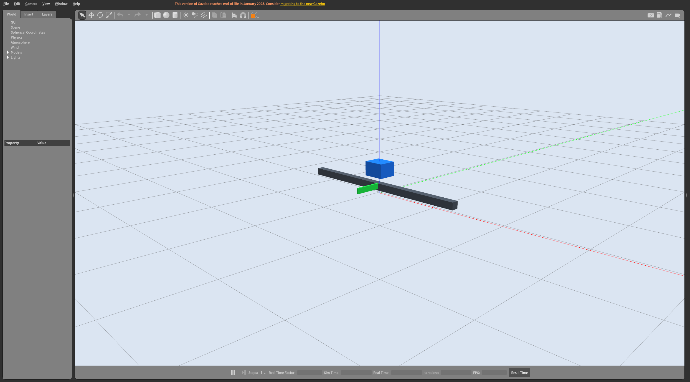

## A48：Gazebo 小车上的 MLP 强化学习

2026-11-04，实机验收 72.721 秒，桌面验收 41.890 秒。每轮使用 1440 次实际控制转移，每次推进 20 个 1 ms 原生物理步，再计入 28 个复位步。独立 Classic SDK 核对共 28828 步；轨迹逐条复算高斯动作、限幅推力和由下一步状态得到的奖励。

每批用当前策略采集四个物理回合，逆序计算奖励到达，减去上一批按时刻统计的基线，再乘外层 γ^t 和未限幅样本的高斯均值梯度。MLP 梯度裁剪后执行上升。六次更新后重新加载权重，使用与训练前相同的两组初值和噪声评估。平均折扣回报 −10.7385 → −10.7056；两组变化分别 −0.2683、+0.3342，不能由此推断收敛或泛化。参考演示和临时填空验收分开，重入保留个人文件和旧成果。

独立图形捕获曾遇到 Classic 退出时触发 Boost 断言。框架提交 `244f652` 增加经对端身份认证的套接字清理。两次实机 SIGKILL 探针确认正常析构缺席时可删除已认证端点，且同名替换文件保留；最终图形捕获和关闭通过。16 项单测在 Windows 和 ikaros 通过。完整逐步轨迹、权重和独立探针数据保存在两端 `.deploy/addons/A48`，[验证记录](verification/A48.json) 含文件摘要。

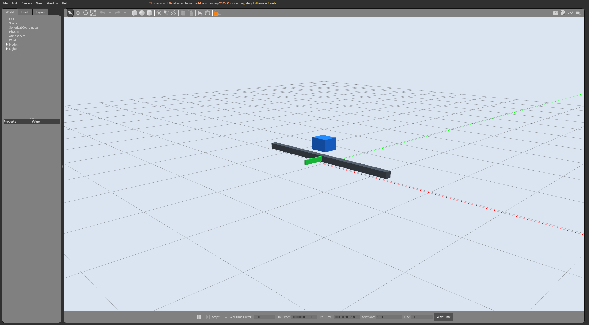

## A49：实际四旋翼推力、串级控制与阵风恢复

2026-11-04，独立实机验收 46.349 秒、桌面 29.119 秒。外环由世界坐标位置和速度计算加速度及高度 PID 输出，按当前航向映射成姿态目标；内环用姿态和机体系角速度计算三轴力矩。加上倾角补偿后的总推力，经十字形混控分配到四个旋翼，分别限制在 0–6 N。Gazebo 在四个真实相对位置施力并施加交替反扭矩，原生刚体完成积分。

逐个增加单个旋翼的 0.75 N，原生角速度方向全部与混控预测一致。两个初始高度 0.45、1.55 m，各推进 400 次 20 步控制、其中 75 次叠加指定风力。独立 SDK 核对每轮总计 16002 个物理步，暂停空闲时无额外步。末段高度 RMS 0.01936/0.01912 m，水平 RMS 0.00121/0.00120 m，姿态 RMS 约 0.00024 rad。模型采用理想转子、仿真真值和外加风力，无真机适用性推断。

实测无正常 end 的 EOF 恢复原运行状态，正常关闭只清理所属端点与进程。4 项飞控单测、SDF 检查、实际桌面验收、参考和临时填空分别通过。完整飞行 JSONL 在两端 `.deploy/addons/A49`，[验证记录](verification/A49.json) 附源文件和轨迹摘要。

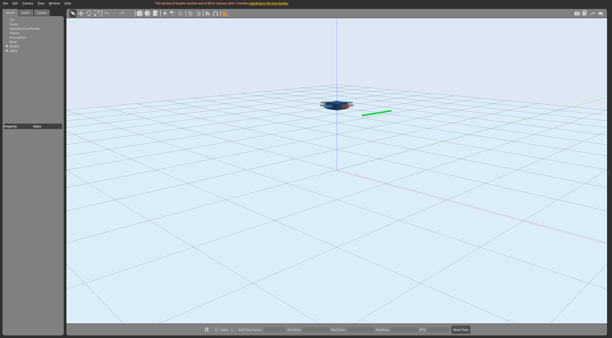

## A50：第一代 FAST-LIO 的滚动雷达、原生 IMU 和实际建图

2026-11-04，固定的第一代源码与 Livox 消息包在 ikaros 的独立 Noetic 工作区编译。16 束 ODE 射线按 0.5 ms 物理步逐列查询；一帧 200 列，最后一列相对首列为 99.5 ms。真实安装按历史版固定外参，Gazebo 原生 IMU 约 200 Hz。140 帧约 44.7 万个真实回波写入原始文件；适配器生成含原采样时间的两话题 bag，首列进 header，逐点纳秒偏移进 CustomMsg，按末列时刻记录 bag。位姿真值单独保留，未向估计器发布。

历史前端按线束分组提取面和边，面点时间排序后进入后端。后端等待 IMU 覆盖有效特征末时刻，传播并去畸变，以局部地图面约束迭代更新；估计输出打上对应特征末时刻。按首个匹配位姿做一次 SE(3) 对齐，无尺度拟合。实机重复两次、同一会话旧文件摘要不变，位置 RMS 0.02921/0.02919 m，姿态 RMS 0.00196/0.00202 rad。桌面最终版本的 130 个匹配位姿位置 RMS 0.02916 m；独立读回实际 `/Laser_map` 导出的 12162 个有限坐标。数字练习与估计器通过分开。

独立重复验收 83.024 秒，桌面验收 52.378 秒。原生几何预检、两个终端、真实 GUI、验收和退出通过，3 项数据审计单测在 Windows 与 ikaros 通过。[验证记录](verification/A50.json) 给出证据摘要，原始点、bag、轨迹和地图在两端 `.deploy/addons/A50/artifacts`。

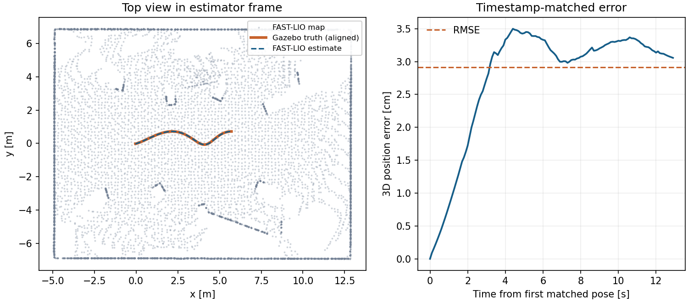

## A51：FAST-LIO2 直接模式与特征模式同源对照

2026-11-04，独立 Noetic 工作区按固定提交编译 FAST-LIO2 和 ikd-Tree。沿用 A50 真滚动传感器，将实际秒偏移与线束分别编码为 PointCloud2 的 float32 time 和 uint16 ring。独立解包校验 140 帧逐点字段、时间顺序、0–15 全线束、99.5 ms 末点及 2860 条真实 IMU 覆盖。每轮以同一个 bag SHA 分别启动新估计器，只有特征开关不同。

两条模式都经 IMU 传播和去畸变，再用局部地图邻域拟合平面，IKFoM 用点到面残差迭代修正状态，最后将新点增量加入 ikd-Tree。特征模式在此之前做线束几何筛选；同步使用保留点实际末时刻。桌面版配对 137 个扫描，136 个位姿与独立真值匹配，直接／特征位置 RMS 0.05108／0.03487 m；两阶段计时和的中位数 5.71／4.96 ms，p95 7.92／6.83 ms。里程计发布调用在建图计时内，后续点云、地图诊断输出及 ROS 传输不在内。结果限于本场景。实际 ikd-Tree PCD 分别核对 14690／13543 个有限坐标。

桌面首轮查到异步根重建时 `validnum()` 返回 `-1`。用原日志重放解析，137 个扫描仍保留，1 个地图计数明确为缺测，其余点数与实测 PCD 均独立核对。最终桌面通过（70.051 秒），实机命令行通过（67.699 秒），3 项单测、实际输入 wire 核查和练习夹具通过。[验证记录](verification/A51.json) 与两端 `.deploy/addons/A51/artifacts` 保留证据和 SHA。

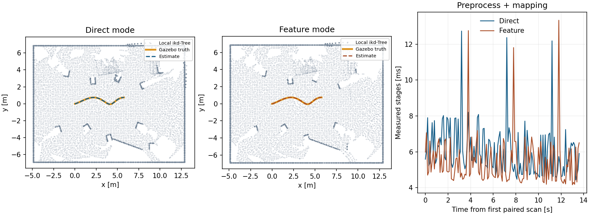

## A52：Point-LIO 逐时刻组更新与输出频率

2026-11-04，原 master 固定源码及其内嵌 ikd-Tree/IKFoM 在独立 Noetic 环境编译。真实滚动点云按采样时刻排序，16 个同时发射的回波共享一个时刻。每个时间组传播状态并用可用地图对应更新滤波器；本课将 IMU 作为观测，保留原生逐轴饱和判据。唯一对照开关是里程计发布节奏。每轮两个估计器回放相同 bag SHA，分别核对输入字段与真值。

两次实测均在 138 个共同原始扫描中得到 27600 次成功更新，每扫发布收到 138 条，按时刻组发布收到 27600 条，未见发布与接收数量差。桌面版的不同 header 时间频率为 10／2000 Hz，0.5 倍回放时墙钟平均约 5／1005 Hz，且组内发布呈突发。共同扫描末 138 个位姿在记录精度下位置差为零；与独立 Gazebo 真值比较的位置 RMS 分别 0.00890／0.00915 m。原生注册帧与初始化地图分别导出，不把最后一帧当全局地图；没有将本基准表述为注入饱和的测试。

实机命令行 91.838 秒、桌面 96.762 秒。两个终端、实际窗口与退出检查通过，3 项单测和输入 wire 核查通过。逐次发布、原生更新日志、输入 bag、匹配轨迹及 PCD 已校验并保存在两端 `.deploy/addons/A52/artifacts`；[验证记录](verification/A52.json) 附摘要。

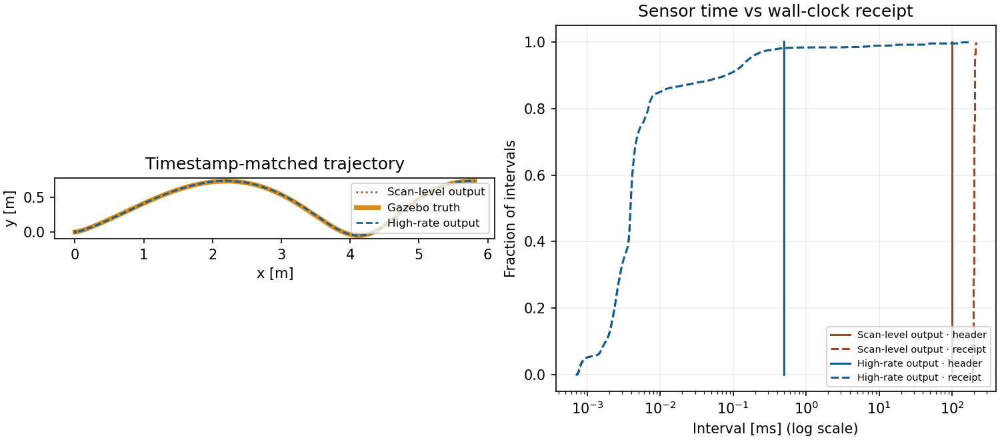

## A53：LIO-SAM 双图、真实回环与历史关键帧

2026-11-04，固定 ROS1 LIO-SAM 和私有 GTSAM 4.0.3 编译通过。将历史 OpenCV 头换成 OpenCV 4 核心头，并移除未用的 GTSAM unstable 头；预积分仍使用原 iSAM2。物理设备用力和力矩绕圈并实际重访，采集 340 帧原生滚动点云、6860 条带姿态的 IMU，分别验证点字段、时间、束号及四元数，真值未发布给估计器。独立真值预检路径 17.05 m，回访距离约 0.13 mm；回访后继续前进给原版回环队列提供关键帧插入机会。

点云按 IMU 陀螺去旋转畸变，再提取边和面，扫描匹配形成顺序位姿因子。独立 IMU 图将原采样预积分，并以偏置与激光位姿校正约束更新，每到第 100 个键用边缘协方差重启；两模式各验到 337 次接受的预积分校正。地图 iSAM2 保留历史关键帧。对同一录包开关回环，分别实际加入 0／5 条回环、均有 43 条顺序因子和 1 条先验。GPS 因子为 0，本轮未验证 GPS。

桌面共有 338 个在线位姿位置 RMS 为 0.03954／0.03896 m；44 个最终共同关键帧为 0.04875／0.04611 m。历史关键帧最大位置修正约 11.85 mm。保存实际回环前地图与两模式最终地图，并核对有限坐标和 SHA；最终地图 13504／13530 点。差异是这个场景的实测结果。命令行 142.470 秒、桌面 147.890 秒，最终实际窗口、终端、验收和退出清理通过。并行启动曾有一次 GLXBadDrawable，独立串行复验通过，未改图形驱动。

首份录包曾在第二帧触发非有限最近邻输入。修复在边线雅可比零距离分母前筛除无定义行，核对近邻数、法向与 QR 位姿更新；同一录包同一帧记录 85 行跳过，此后完成 44 个地图键和 IMU 校正。有效行保持原 QR 与图求解。3 项单测、物理重访预检和数字练习夹具通过。[验证记录](verification/A53.json) 和两端 `.deploy/addons/A53/artifacts` 保留数据、日志、地图和轨迹。

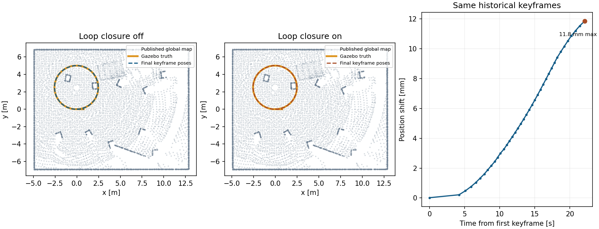

## M01：Harmonic PBR 与独立碰撞

2026-11-04，ikaros 的 Ubuntu 24.04／Jazzy 隔离 GPU 容器、Gazebo Sim 8.15.0 与 Ogre2 NVIDIA RTX 4090。真正 SDF 校验通过，命令行实验 10.338 秒，最终桌面 12.746 秒。探针分别在横梁、地面和 A/B/C 样台实际下落并读取连续稳定位置。A/B 碰撞相同，视觉厚度不同，落点约 0.90／0.90 m；B/C 外观相同，碰撞厚度不同，落点约 0.90／1.10 m。验收分别核对相同和不同的落点差。

初始两根柱子暗黑，Ogre2 实际找到资源目录；默认颜色抑制了纹理。只改为中性白材质颜色后，相同视角与等待时间下棋格可见。在临时副本中仅将右柱 roughness 0.15 改为 0.8，原始 1200×1000 截图对应右柱区域平均 RGB 通道绝对差约 20.34/255，左柱和横梁对照区域为零。渲染与物理证据分别保留，未把像素差用作物理判据。两个真实 PTY、图形窗口、验收与退出清理通过。[验证记录](verification/M01.json) 和两端 `.deploy/addons/M01` 保存证据。

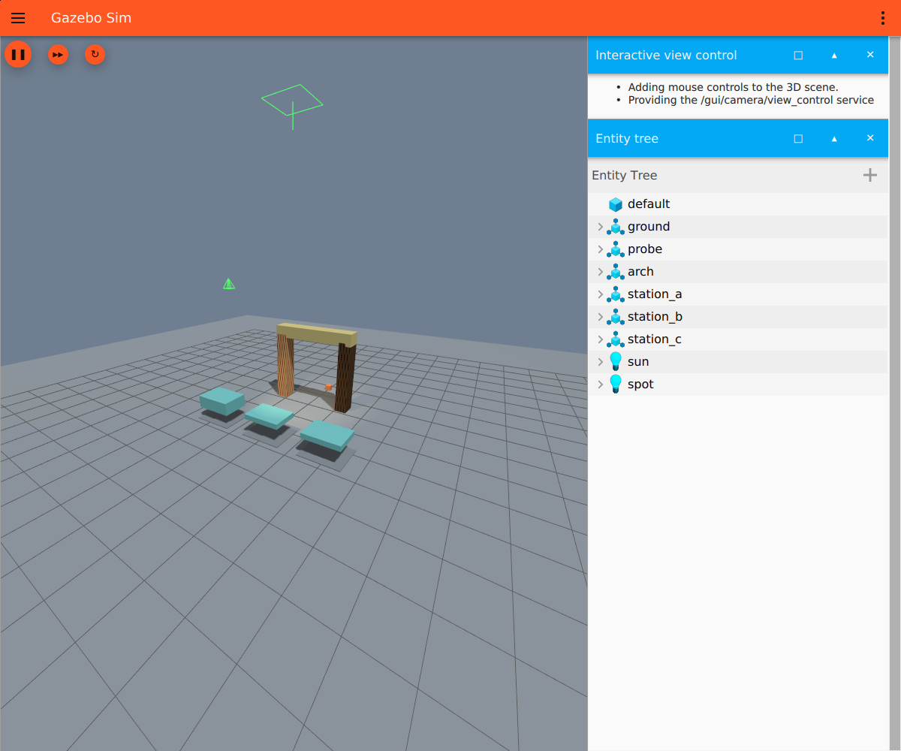

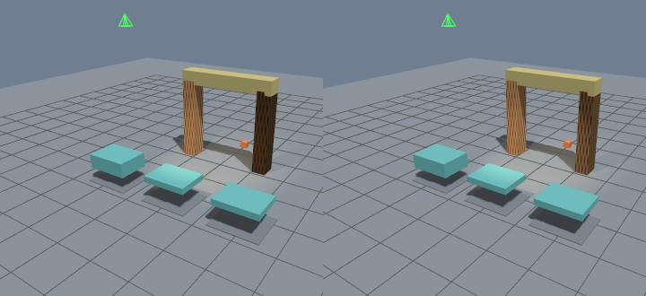

## M11：Harmonic 差速轮地运动、GPU 激光与 ROS 2 桥

2026-11-04，Jazzy／Harmonic 8.15.0 的 ikaros 隔离 GPU 容器通过。修正车轮关节轴在模型坐标中表达，实际 DiffDrive 将 ROS 2 桥入的速度转为轮速。脚本先发零命令并建立本轮原生位姿，再按真实仿真时刻控制直行和转向。原生关节状态核对同号直行、异号转弯，世界位姿与桥出的里程计分别测量。桌面直行约 0.4633 m，转向约 0.658 rad；181 束 GPU 激光前方中位距 3.7011→3.2377 m，桥前后差约数微米，零命令后观察窗口内未见位姿漂移。

SDF 检查有效（解析器对 Gazebo 的 `gz_frame_id` 扩展给提示），命令行 12.449 秒、同一会话两次 18.103 秒、桌面 14.566 秒。真实 GUI 小车与墙、实体树、两个终端、验收和退出清理均核对。[验证记录](verification/M11.json) 含两次结果，完整日志在两端 `.deploy/addons/M11`。

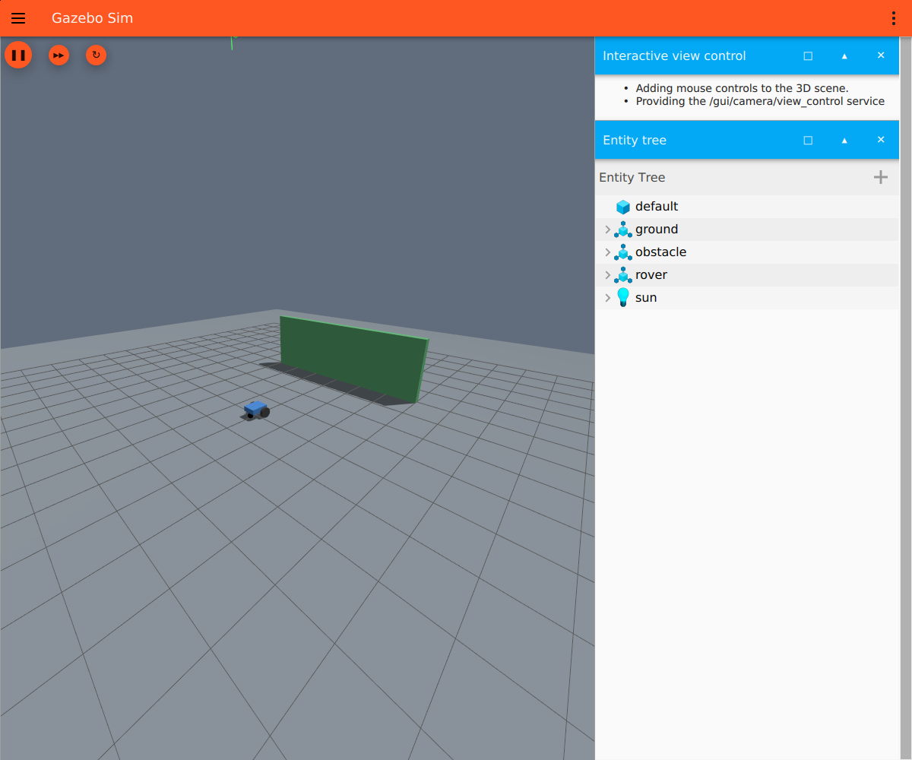

## M22：真实 DDS QoS 与仿真时钟

2026-11-04，Jazzy／Harmonic 的实际 Fast DDS 环境通过。BEST_EFFORT 发布端发现两个订阅端，只与兼容端匹配；兼容端收到 0–11，RELIABLE 请求端未收包且触发 RELIABILITY 不兼容事件。TRANSIENT_LOCAL 晚加入者收到 10–13，VOLATILE 仅收到加入后的 13。两个可靠订阅者收到中间件确认后再运行回调，深度 3 保留 9–11，深度 16 保留 0–11。发布端、订阅端与队列设置分别观测。

ROS 时钟单向由 ros_gz 桥入，两个实际纳秒消息夹住独立读取的 Gazebo 时刻。命令行 7.068 秒、同会话两次 7.059 秒、桌面 9.325 秒；真实窗口、终端和退出清理通过。[验证记录](verification/M22.json) 保留实际序号、QoS 端点和时钟数据，原日志在两端 `.deploy/addons/M22`。

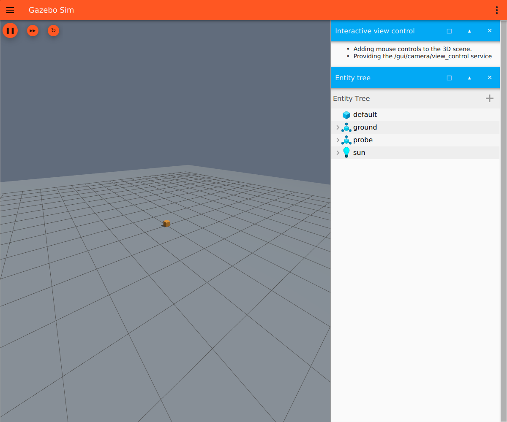

## M23：Jazzy 导轨服务、Action 与参数

2026-11-04，实际 colcon 生成本课 MoveRail 和 ReadRail 类型。服务返回新鲜关节位置；Action 接受合法单个目标，用误差和实时 gain 生成受限速度，经 ros_gz 桥驱动实际导轨。反馈来自 Gazebo 关节而非计数器。非法和并发目标均拒绝，取消结果状态为 CANCELED，实际滑台约 0.1982 m 停住，观察窗口无漂移；成功目标约 0.5382 m，实际约 0.5176 m，在误差容限内且速度归零。无效范围及类型的增益被拒绝；运动中将 0.8 调为 1.8，实际反馈记录到两段控制计算，原参数随后恢复。

复测发现服务可发现早于桥交付；增加实际 DDS 命令匹配和两个递增关节时刻的就绪门槛，运动前再次检查。修正后命令行 14.567 秒、同一会话两次 17.141 秒、桌面 17.120 秒；真实 Gazebo 窗口、两个终端与退出清理通过。[验证记录](verification/M23.json) 包含反馈，原日志在两端 `.deploy/addons/M23`。

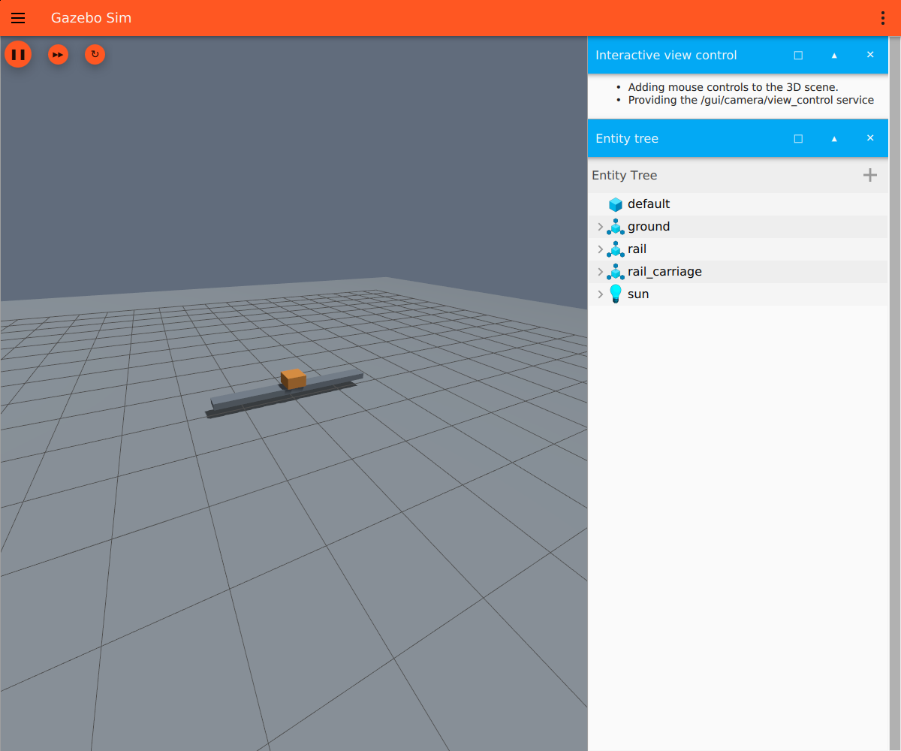

## 后续目标

M24–M26：按计划逐门建立活动目标、真实验收、提交推送后追加记录。目前不能因本地存在草稿就计为完成。
