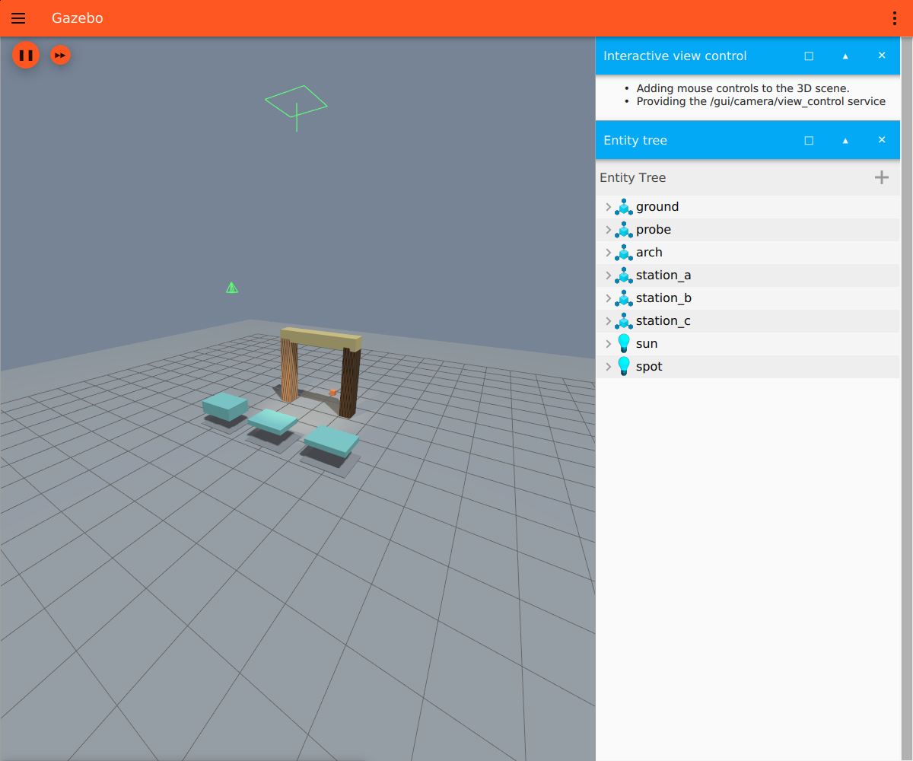

# Gazebo Sim 与 ROS 2 适配说明

此文描述附加教学包采用的新运行接口。原有 Classic 11 / Noetic 课程、编号和个人练习保持独立；现代课程的编写、实际验收和交付逐课记录。框架能启动某个版本，不代表所有课程已经在该版本验证，也不代表 Classic 插件能够原样运行。

## 版本边界

| 环境 | 运行配置 | 说明 |
|---|---|---|
| Ubuntu 20.04 + Classic 11 + Noetic | `classic11-noetic` | 保留现有课程及其原验收基线 |
| Ubuntu 24.04 + Gazebo Harmonic（Sim 8）+ ROS 2 Jazzy | `harmonic-jazzy` | 现代课 01、11、22–26 |
| Ubuntu 22.04 + Gazebo Fortress（Sim 6）+ ROS 2 Humble | `fortress-humble` | 同七门课的 Fortress 变体 |
| Sim 6 或 Sim 8，未安装对应 ROS 2 | 对应课包中 `requires_ros=false` 的课 | 例如 01 独立 SDF 实验 |
| 其他 Gazebo 主版本和 ROS 2 组合 | 按课显示兼容性 | 教材仍可阅读 |

Humble 的官方默认配对是 Fortress，Jazzy 的默认配对是 Harmonic。安装状态和当前 shell 的激活状态分开记录。[Gazebo 官方配对表](https://gazebosim.org/docs/fortress/ros_installation/)

## 环境检测的算法流程

1. 从系统探测 Classic 与 ROS 安装，分别为每个现代配置建立子环境。先移除外层 shell 的 ROS、overlay、Gazebo 插件及配置路径，再加载选定的 `/opt/ros/<发行版>/setup.bash`，保留图形会话变量。
2. Fortress 读取 `ign gazebo --versions` 并要求主版本 6，Harmonic 读取 `gz sim --versions` 并要求主版本 8。检测同时核对 ROS 2 发行版，在各自子环境中读取工具路径和 `ros2 pkg list`，结果写入 `modern.by_profile`。
3. 课表加载器按每课清单的 `variants` 声明建立对应条目，读取这个课包的 SDF、桥接和依赖。GUI、命令行和环境报告使用同一兼容性规则。主版本不符、依赖缺失和探测失败分别显示。
4. 本机执行后端按课包建立会话，个人副本和学习记录以 `课包 + 课号` 区分。两套版本可共用教材和实际行为验收程序，各自加载世界文件和 ROS 接口。

## 会话启动、控制与清理

现代运行器继承已有练习存储、日志、真实 PTY 终端、验收记录和进程所有权管理，替换模拟器相关接口：

**个人副本 → 子环境 → domain 租约 → prepare → 启动所选 Gazebo Sim → control 服务与实际统计就绪 → 辅助节点 → GUI/终端 → 实验操作。**

- 每次实验使用不可预测 token，`GZ_PARTITION` 与 `IGN_PARTITION` 都包含该 token。
- ROS 2 使用 DDS，不启动 `roscore`。应用在当前 Linux 用户的文件锁租约中分配 `ROS_DOMAIN_ID` 20～99，避免本应用不同会话复用 domain；发现范围限定本机。此租约不能替外部程序预留 domain，外部项目仍应使用自己的 domain。
- 分别启动服务端（`-s -r`）和 GUI（`-g`）。Fortress 使用 `ign gazebo --force-version 6` 和 `ignition.msgs.*`，Harmonic 使用 `gz sim --force-version 8` 和 `gz.msgs.*`。关闭 GUI 后可单独重开。
- 就绪检查同时要求 `/world/<name>/control` 服务与真正的 `WorldStatistics`。仅有进程或端口不算世界就绪。
- 暂停与继续发送一次 `WorldControl` 请求，再订阅新统计确认实际 `paused`。服务 Boolean 只表示请求接收，不能代替行为结果。
- 单步先确认暂停，读取基准迭代数 I，发送一次 `multi_step=N`，只在实际统计显示 `iterations=I+N` 且仍暂停时报告成功。超时或额外客户端导致迭代超标时报告不确定/失败，不自动重发控制。
- 查询和控制 CLI 都是本会话拥有的进程，使用有界超时；退出通过 token、UID、PID 启动时间与进程组身份只清理本课。释放 DDS domain 租约发生在进程清理之后。

### 必须保留的语义差异

**Fortress Sim 6 和 Harmonic Sim 8 均不支持保持时钟的仅模型复位。** 上游 `OnWorldControlState` 仍可能返回 Boolean true。[Fortress 实现](https://github.com/gazebosim/gz-sim/blob/ign-gazebo6/src/SimulationRunner.cc) · [Harmonic 实现](https://github.com/gazebosim/gz-sim/blob/gz-sim8/src/SimulationRunner.cc)

因此本运行器明确拒绝该操作，提示使用“重启实验”恢复整个场景。没有悄悄替换成 `reset.all=true`，因为后者会使仿真时间归零并影响 TF 缓存、控制积分与录包。关于完整 reset 的实际接口见[官方 Reset 说明](https://gazebosim.org/api/sim/8/reset_simulation.html)。

Classic 的 Model/World/Sensor/Visual/GUI/System 插件分类不直接映射为现代课程代码。现代 Gazebo 使用实体组件管理与系统插件；ROS 2 通过 `ros_gz_bridge` 显式桥接支持的消息类型。`rostopic`、`roslaunch`、全局参数服务器和 `gazebo_ros_api_plugin` 均不会混入现代课。

## 运行入口

在准备好的 Ubuntu 22.04 或 24.04 图形环境安装系统 PyQt5 后，从本仓库源码目录执行。下面的启动和验收命令以 Humble 为例。

```bash
./launch.sh --diagnose
./launch.sh --list
./launch.sh --profile fortress-humble
./launch.sh --profile fortress-humble --smoke 11 --gui --terminals
```

使用 Jazzy 时将 `--profile` 的值换成 `harmonic-jazzy`。启动时也可由应用自动选择检测到的课包。

基础依赖可由用户按官方源准备：

```bash
sudo apt update
# Ubuntu 22.04 + Humble
sudo apt install python3-pyqt5 ros-humble-ros-gz xterm
# Ubuntu 24.04 + Jazzy
sudo apt install python3-pyqt5 ros-jazzy-ros-gz xterm
```

具体 ROS 2 课程会额外声明 `rclpy`、`tf2_ros`、`rosbag2_py`、`robot_state_publisher`、动作消息和 colcon 等依赖。`gz_ros2_control` 不是原生关节 PID 的别名，需自己的硬件接口、控制器配置及真实反馈验收；不能由安装 `ros_gz` 推断它已经可用。

Jammy 上运行全部七课时，可在 Humble 官方软件源配置完成后补齐以下依赖。

```bash
sudo apt install build-essential cmake python3-colcon-common-extensions \
  ros-humble-rosbag2-py ros-humble-rosbag2-storage-default-plugins \
  ros-humble-robot-state-publisher ros-humble-rosidl-default-generators \
  ros-humble-rosidl-default-runtime ros-humble-ros2lifecycle
ign gazebo --versions
./launch.sh --diagnose
```

Humble 课 24 使用该发行版的 SQLite 存储插件，课 23 用本课私有 colcon 工作区生成服务和动作接口。Gazebo 窗口、PBR 和 GPU 激光需有实际可用的 Ogre2 渲染环境。

Docker 可作为隔离的 Ubuntu 22.04 或 24.04 用户环境，从容器内部启动同一桌面应用；平台原有 Docker 连接配置接口与本机执行是两件事。本说明没有将“保存 Docker 配置”描述为已实现容器调度。GUI 需要实际 X11/Wayland 显示转发，GPU 激光还需可用的渲染上下文；不应为了演示开放全局 X 访问或替换宿主驱动。

## 框架验证入口

```bash
python3 -m unittest tests.test_modern -v
python3 tests/modern_runtime_acceptance.py --profile fortress-humble --gui --terminals \
  --output .deploy/fortress-framework-gui.json
```

自动框架验收使用 `tests/fixtures/modern_diagnostic`：真正落块到地面、暂停、精确单步/十步、继续、两个同时存在的真实世界的 partition/domain 分配、结束第一个世界而第二个继续推进，以及本测试所有 token 无残留进程。该测试确认域号不重复，没有将域号租约等同于已验证 DDS 消息隔离。

可选 GUI 验收除独立重开外，必须通过 X11 `_NET_WM_PID` 找到属于该 GUI 进程组且带本课 token 的真实映射窗口；使用 Qt 抓取初始与重开后的窗口，记录 PNG、尺寸和 PID，供视觉检查。截图还必须通过采样颜色数、亮度跨度与非黑像素比例检查；GL drawable 失败造成的纯黑/空白窗口在有界等待后使验收失败，保留 `rejected-blank.png` 和像素指标。只看到 GUI PID 存活、窗口尺寸正常或PNG保存成功不会计为图形通过。

像素变化只是拒绝黑屏的必要条件，不能证明场景、材质或机器人正确；报告始终保留 `manual_scene_review_required=true`，实际三维场景需查看截图独立确认。可选终端验收检查真实交互 PTY。

该 fixture 不计为课程，也不代表 PBR、激光、ROS 2 动作或控制器已验收。单元测试检查版本边界、ROS 环境隔离、消息解析及不确定步进不得误报成功；真实 Gazebo 验收报告与课程自己的行为验证分别记录。最终验证状态由实际输出报告决定，本设计文档不提前宣称全部平台已通过。

## 官方先修入口

G03已在隔离Ubuntu24.04.5 / Jazzy / Sim8.15.0中验证基础运行器、桌面、真实Gazebo窗口和PTY，详见[逐阶段验证记录](EXPANSION_VALIDATION.md)。本次软件Mesa直接连接宿主NVIDIA X服务器曾出现全黑窗口，失败记录保留；最终通过现有驱动对应库的只读绑定和设备透传完成图形核对。宿主驱动与Docker配置均未改动。这不是任意容器/显卡都可用的承诺。

常规NVIDIA容器环境按[NVIDIA Container Toolkit官方指南](https://docs.nvidia.com/datacenter/cloud-native/container-toolkit/latest/install-guide.html)配置运行时与设备，图形能力及X11授权还需分别验证；不要把仅有CUDA计算可用视为GUI渲染已可用。中文桌面还需`fonts-noto-cjk`等中文字体。此处只链接环境配置，不会由平台启动时自动改写宿主配置。

- [ROS 2 与 Gazebo 桥接](https://gazebosim.org/docs/harmonic/ros2_integration/)
- [ROS 2 QoS 的请求与提供兼容规则](https://docs.ros.org/en/jazzy/Concepts/Intermediate/About-Quality-of-Service-Settings.html)
- [ROS 2 Python 动作](https://docs.ros.org/en/jazzy/Tutorials/Intermediate/Writing-an-Action-Server-Client/Py.html)
- [ROS 2 URDF 教程](https://docs.ros.org/en/jazzy/Tutorials/Intermediate/URDF/URDF-Main.html)
- [gz_ros2_control](https://control.ros.org/jazzy/doc/gz_ros2_control/doc/index.html)

## 2026-11-04 Fortress／Humble 实测

课程代码基线为 `4e9abc672d861d5cb89c9e7924b96325de88895f`。Fortress 在 ikaros 的 Ubuntu 22.04.5 GPU 容器实测，使用 Sim 6.18.0、ROS 2 Humble、Transport 11.4.2、ROS 桥 0.244.26 和 NVIDIA RTX 4090 的 Ogre2。Harmonic 在同一主机的独立 Ubuntu 24.04 GPU 容器复验。两套环境分别运行 01、11、22–26，七门课的真实行为验收全部通过，Fortress 逐课开启 GUI。

| 课程 | Fortress 实际观测 |
|---|---|
| 01 PBR／碰撞 | 只改碰撞的两块样台落点差 0.200 m，只改视觉时落点差约 0.026 mm。课内自动验收读取真实落点，PBR 观感在原生窗口查看。 |
| 11 差速／GPU 激光 | 仿真小车前移 0.443 m，181 束激光中的正前方测距减少 0.443 m，旋转约 0.675 rad。 |
| 22 QoS | BEST_EFFORT 发布与 RELIABLE 订阅产生实际不兼容事件，兼容端收到 12 条；历史深度 3 保留最后 3 条，后加入的 TRANSIENT_LOCAL 订阅收到历史数据。 |
| 23 服务／动作 | 私有 colcon 构建并调用生成接口；滑台到约 0.449 m，第二个动作取消后停在约 0.131 m，测量窗口内无位移漂移。 |
| 24 TF／rosbag2 | 20 步对应 20 ms；SQLite 原始消息按重映射重放 13 条时钟、24 条动态 TF 和 1 条静态 TF，重建历史变换，实时 `/clock` 发布者保持一致。 |
| 25 URDF／关节 | URDF 转换后保留固定工具连杆，三个角度的原生工具位置与 TF 的最大差约 3.7 mm。 |
| 26 colcon／生命周期 | 从私有安装树启动，两轮激活各转发 9 条原始 IMU 数据。其余观测阶段转发为零，原生角速度约 0.55 rad/s。 |



24 首轮记录成功后在播放器就绪检查失败，原因是 Humble 的 `rclpy.Subscription` 缺少匹配发布者计数方法。Humble 路径改为在播放器暂停时通过 ROS 图核对重映射话题的发布者身份、类型和 QoS，等待继续服务后才播放。回放仍逐条比对 CDR，并检查实时仿真时钟和发布者身份。

运行器实测真实落块、暂停后 1 步／10 步分别推进 1 ms／10 ms、继续、GUI 独立重开、双终端，以及双会话独立分区和 DDS 租约。两个现代环境的 Qt 端到端检查均通过，包含自动选择课包、课内验收、切课清理和个人练习保留。Classic 原生、Humble 和 Jazzy 各通过 284 项单元测试；Classic 另回归首课真实落块。原始报告及运行日志保存在 ikaros 仓库的 `.deploy/fortress` 和 `.deploy/fortress-validation/platform-evidence`。
